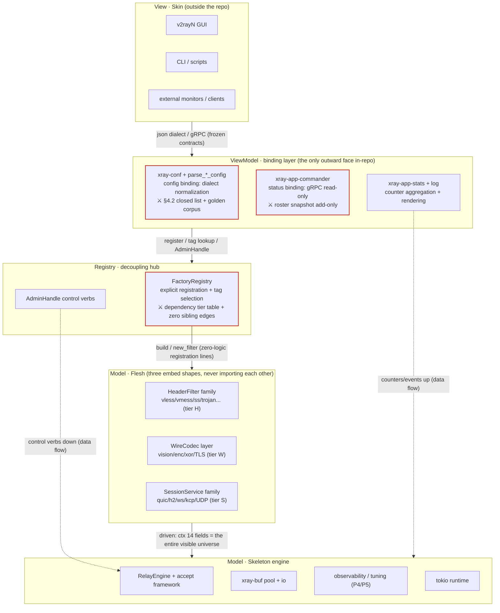

# Xray-core-rust Layered Constitution (ARCHITECTURE.en.md)

> **Force**: this is a governance document. Every new protocol and every AI subagent dispatch aligns on this map first, then acts.
> **Details live elsewhere**: the full rulings are in [`docs/refs/oracle-framing-arch.md`](docs/refs/oracle-framing-arch.md) (v1 ruling), [`docs/refs/oracle-framing-v2.md`](docs/refs/oracle-framing-v2.md) (v2: data-plane Filter/engine), [`docs/refs/oracle-framing-v3.md`](docs/refs/oracle-framing-v3.md) (v3: MVVM addendum); the defect inventory in [`docs/refs/alloc-audit-report.md`](docs/refs/alloc-audit-report.md) (AllocAudit). The constitution sets rules; details follow the links.
> 中文版: [ARCHITECTURE.md](ARCHITECTURE.md)（主文档为中文版；本英文版跟随其同步修订，变更记录双记 / The Chinese file is the master; this English version is revised in lockstep with dual changelog entries）。
> **Annotation discipline**: `[Current]` = shipped and grep-verifiable; `[Planned]` = ruled upon but not landed. Never write plans as current; never document un-stabilized APIs.
> **Layered reading**: the compact block at the head of each section is the approved 138-line baseline (the TL;DR layer); the `Details` subsections are the expansion. Reading only the TL;DR layer aligns you on the map; actually building a protocol requires the full §3 recipe — this document is written to the standard "a developer who missed every decision session can build correctly from this file alone".

## 0. TL;DR — The MVVM Five-Layer Panorama

### 0.1 The metaphor and the dependency direction

The project owner's metaphor: **Skeleton layer (骨架) = GameFrameWork** (memory allocation & scheduling, thread management, resource reclamation — all framework-hosted); **Protocol flesh (血肉) = protocols and DNS** (protocol-logic development only); **Skin adapters (皮囊) = V2rayN-class clients** (the integration layer).

> Solid lines = dependencies (one-way downward: View→VM→Registry→Flesh→Skeleton, never reversed); dashed = data flow (counters up, control down). ⚔ = mechanized checkpoints. (Figure migrated verbatim from v3 §4; labels kept bilingual with the master.)



How to read it in three sentences (v3 §4): **dependencies point only downward** (View never knows Model exists; flesh never knows commander exists); **the three ⚔ are the enforcement points of all discipline** (config snapshot, roster snapshot, dependency tier table — three CI checks govern the whole MVVM); **flesh's visible universe = the frozen ConnCtx fields (14+1, §6.4) + the registry** — everything else, being invisible, is unusable.

Dependency direction: View → ViewModel → Registry → Flesh → Skeleton, strictly one-way.
Flesh never imports the ViewModel (commander/stats/conf); protocols never bypass the skeleton for buffering / scheduling / accept / stats.

Flesh scope: the 17 `xray-proxy-*` crates + the protocol-semantics portions of each transport + `xray-app-dns` and the protocol-bearing parts of the app modules (their hosting surfaces — connections, buffers, scheduling — remain skeleton).
Skin scope: cli assembly, config-form compatibility, the commander API.

Verdict on the game-engine analogy: **copy "resource hosting + fill-in hooks"; do not copy "central frame loop / runtime takeover / fully hidden memory."**

### 0.2 Skeleton components at a glance

| Skeleton component | Status |
|---|---|
| Scheduling engine | [Current] tokio IS the scheduler: spawn/IO/timers fully hosted; no executor wrapper layer (there never will be one) |
| Buffers & pool | [Current] xray-buf's 11 modules mirror Go `common/buf` file-for-file; two-tier pool (TLS cache + 8-shard global, 2K/8K/32K/128K); `Buffer` is `#[must_use]` and returns to the pool on Drop; `copy_with_options` is a literal translation of Go `buf.Copy`. [Planned] a zero-copy ingress `Buffer::from_bytes_frozen` for `Bytes`; de-boxing the io.rs Reader/Writer traits (poll-based + named-future default methods; a `BoxedReader` adapter at connection boundaries costs 1 box per connection) |
| Transport abstraction | [Current] the `xray-transport-*` crate family; security (tls/reality) wrappers live in separate crates to break dependency cycles |
| Dispatcher | [Current] DefaultDispatcher + decorator chain (SizeStat/Cached/EndpointOverride) + the splice admission gate (Go `CanSpliceCopy` 1/2/3 semantics). [Planned] decorators forward poll directly: 1 box per layer → 0 allocations |
| Connection engine | [Planned · P2.5 (v2)] RelayEngine = DialBridge generalization: unifies the 5 fragmented pumps; RelayFilter's three callbacks (poll_decode/poll_encode/on_event); vmess inbound migrates first |
| Registry | [Planned · P2.0 (v3)] FactoryRegistry explicit registration + config-tag selection: the central outbound/inbound match arms degrade to zero-logic registration lines; arm-embedded construction logic moves back into flesh with the arm (BuildCtx makes environmental deps explicit) |
| Unified accept | [Current] hand-rolled loops per transport + spot 4s timeouts (httpupgrade/websocket each hand-copied); serial-accept residue (a slow ClientHello occupies the accept slot); httpupgrade's PROXY protocol read sits outside the timeout window. [Planned] `accept_loop` + `AcceptLimits` + `StreamHandshake` generic handshake callback (monomorphized, zero box); QUIC/UDP get their own thin template — no forced unification |
| Observability | [Current] stats counters + debug logs — thin. [Planned] per-stage atomic counters + periodic tracing (accept rate / handshake-latency histogram / timeout count / active conns), relay backlog watermark; no metrics framework |
| Tuning surface | [Current] window/timeout constants are hardcoded (the 88m0 receive-window pin and the enc8x h2-window pin each cost a code→CI→kernel-swap cycle, ~4 hours). [Planned] constants become config: default TCP SO_RCVBUF, h2 STREAM_WINDOW/max_send_buf, hyper send_buf, bridge idle (300s/1s), handshake timeout |

### 0.3 Details — the reusable-parts inventory (grep this list before building anything)

**Before rolling anything by hand, check this table** — anything the skeleton already provides, flesh must not rebuild (the positive counterpart of §1.1's obligation boundary):

| Category | Existing parts (crate names verified) | How to reuse |
|---|---|---|
| Transports (9) | `xray-transport-{tcp,websocket,httpupgrade,splithttp,grpc,kcp,quic,hysteria,naive}` (+ the `xray-transport` core carrying bridge/record_framer/finalmask/mkcp) | Selected via `streamSettings.network`; protocol layers never write their own dial/listen |
| Security wrappers | `xray-tls` / `xray-reality` (separate crates; symmetric inbound/outbound checks) | Via `streamSettings.security`; never inside a protocol crate (dependency-cycle rule) |
| Data-plane aids | `xray-mux` (multiplexing), `xray-xudp` (UDP sessions), `xray-crypto`, `xray-geodata` | mux via `mux.json`; UDP via UdpDispatchSession + the XUDP frame convention |
| App control plane | router / dns / stats / log / policy / metrics / observatory / reverse / geodata / version / proxyman / commander | Injected via config assembly; protocol layers never reach in directly |

### 0.4 Document conflict resolution order

This constitution > the four governance inputs in `docs/refs/` (v1/v2/v3 rulings + audit details) > memory-bank lessons (possibly stale). **Whenever any document contradicts the code, the code wins** — fix the document; if the document is right and the code looks wrong, report the suspected bug, don't fix code from a documentation task. Every `[Current]` claim here carries an anchor — verify the anchor before citing it.

## 1. Skeleton Promises

### 1.1 TL;DR

What flesh **gets** (promises; a missing promise is a skeleton bug):

| Promise | Content |
|---|---|
| pooled buffers | pooled handles return to the pool automatically (`#[must_use]` + Drop); [Planned] a copy-free path for external `Bytes` into the pipeline |
| accept hosting | connection lifecycle, concurrency caps, whole-handshake timeout, close/abort — protocols only fill in the handshake callback |
| scheduling hosting | threads, timers, connection pumps, half-close windows; protocols spawn no threads and own no timeout polling |
| observability | per-stage counters and error-counter hooks; [Planned] gauges / backlog watermarks |
| hot tuning | [Planned] window/timeout changes via config — no code change, no kernel swap |
| logging discipline | errors uniformly classified and counted; issues locatable to a stage from the logs |
| escape hatches | the splice admission gate and opt-in readv are first-class citizens, each with its own benchmark; never deleted as a side effect of "unification" |

What flesh **never builds itself** (obligation boundary): ① no raw heap allocation on hot paths (clippy red line, §6); ② no hand-written accept loops, no self-rolled timeout/rate limiting (today's spot 4s patches are debt, not a pattern); ③ no spawning threads, no wrapping executors; ④ no bypassing the dispatcher with self-built stats/log channels; ⑤ no local window/timeout constants (take skeleton defaults; special needs go through the config surface [Planned]).

**The flesh-visible five-piece set (v3 §7.4: the final form of §1's promises, positive list frozen)**:

| # | Facade | Entry | Promise |
|---|---|---|---|
| 1 | logging facade | `ctx.event(level, msg, fields)` — the engine builds the span at accept; conn_id/stage/inbound_tag/target/email attach automatically; a peer disconnect is never ERROR (levels follow the RelayError classification) | P6 |
| 2 | event manager | lifecycle = engine pre-wiring (zero flesh action); tier S may `ctx.subscribe_mgmt()` for hot-reload | P8 (§1.3) |
| 3 | buffer pool | `ctx.alloc()` / `ctx.scratch()` | P1 |
| 4 | supervised scheduling | `ctx.spawn_supervised(name, fut)` — session-table registration, terminal reclamation (seals the s9/s10 leak class) | P3 |
| 5 | hot-tuning reads | `ctx.tuning() -> &TuningSnapshot` — read-only snapshot + generation; writes belong to AdminHandle | P5 |

**Beyond the five, all banned**: direct tokio (tier-S whitelist exception unchanged), sockets, log macros, self-built channels, global statics, self-parsed config. Negative-list enforcement: the §6.4 clippy trio. The positive list's value: a flesh developer needs only these five to write a protocol — the skeleton is to flesh what the ViewModel is to View: a stable interface.

### 1.2 Details — each promise as a triple (current anchor + planned sketch + acceptance)

**Promise 1: pooled buffers.**
- Current anchors: `crates/xray-buf/src/alloc.rs:21-40` (DEFAULT_SIZE 8192; TIER_SIZES [2048,8192,32768,131072]; 8 blocks per tier in the TLS cache; 8 global shards × 64 blocks per tier; 60s lazy sweep approximating Go sync.Pool's GC cadence); `buffer.rs:35` (`Buffer::new()` goes through the pool), `buffer.rs:60-63` (`from_vec` copy-constructs — the zero-copy gap, canonically), `buffer.rs:372` (`release()`), `buffer.rs:388-396` (`impl Drop` returns to pool); `io.rs:76-93` (Reader/Writer traits boxing `Pin<Box<dyn Future>>` per call — the canonical box tax).
- Planned sketches (transcribed from oracle ruling §2.2):

```rust
// [Planned · P1] Zero-copy ingress: the Rust homecoming of Go's read-only ownership form
impl Buffer {
    /// Holds external Bytes (zero-copy, read-only semantics, Drop does NOT return to pool)
    pub fn from_bytes_frozen(data: Bytes) -> Self;
}
// The interior becomes enum { Frozen(Bytes) | Pooled(BytesMut) } with branch-on-read
// iter()/as_ref() — one branch per chunk, traded for "the API has a path, so discipline matters".

// [Planned · P1] io.rs de-boxing: poll-based trait + named-future ergonomics
pub trait Reader: Send {
    fn poll_read_multi_buffer(&mut self, cx: &mut Context<'_>)
        -> Poll<Result<MultiBuffer>>;
    fn read_multi_buffer(&mut self) -> ReadMultiBuffer<'_, Self>
        where Self: Sized { /* named future: zero box on the generic path */ }
}
// Decorators forward poll directly = 0 allocations per layer; the BoxedReader adapter at
// connection boundaries = 1 box per connection, and only there.
```

- Acceptance: the counting allocator proves hyper `Bytes` → MultiBuffer → relay at 0 copies end to end; loopback matrix ≥ the 154-167MB/s baseline; decorator-chain alloc/MB visibly drops.

**Promise 2: accept hosting.**
- Current anchors: `xray-transport-httpupgrade/src/register.rs:100-151` (serial loop, conn-by-conn await), `:111-114` (PROXY protocol read outside the timeout window — residual P0), `:123-150` (spot 4s), `:98-100,205-208` (abort_handle pattern — the seed of framework-owned lifecycle); `xray-transport-websocket/src/server.rs:119-125` (same-shape 4s).
- Planned sketch (oracle §3.2, verbatim):

```rust
// [Planned · P2]
pub struct AcceptLimits {
    pub handshake_timeout: Duration, // default 4s, configurable (config surface in P3)
    pub max_pending: usize,          // semaphore cap, defeats slowloris slot-occupation
    pub max_conns: usize,            // total concurrency watermark
}
pub trait StreamHandshake: Send + Sync + 'static {
    type Conn: Connection;
    type Fut: Future<Output = io::Result<Self::Conn>>;
    /// Receives the bare TCP stream in one shot (the framework reads nothing);
    /// PROXY / TLS / upgrade all live inside the implementation
    fn handshake(&self, stream: TcpStream, remote: SocketAddr) -> Self::Fut;
}
pub fn accept_loop<H: StreamHandshake>(listener: TcpListener, hs: H, limits: AcceptLimits);
// Loop body: accept → semaphore.acquire() → tokio::spawn(timeout(limits, hs.handshake(..)))
// Generic monomorphization, zero box (the callback uses the `type Fut` associated type,
// never Arc<dyn Fn -> BoxFuture>).
```

- Boundary table: into the framework = accept loop & concurrency caps / whole-handshake timeout / per-stage counters / close-abort lifecycle / slow-attack suite; stays in the transport = PROXY parsing, TLS accept (REALITY detection, ForceEd25519, keyshare policy), ALPN routing, HTTP upgrade semantics, cert selection, all protocol semantics. QUIC/UDP do not enter the same trait (quinn's two-level accept semantics differ; forcing unification = a second proxyman) — they reuse the limits + observability helpers via a thin template. Escape hatch: transports with special accept needs (grpc's h2 serve) may bypass accept_loop and hold the listener directly — the framework does not monopolize the listener, it only provides default-correct.
- Acceptance: timeout/semaphore/close-abort unit tests; slowloris filling max_pending raises new-connection latency instead of starving; permits released after timeouts; `grep -r "listener.accept" crates/` leaves only the framework and the QUIC template.

**Promise 3: scheduling hosting.**
- Current anchors: the tokio runtime hosts spawn/IO/timers globally; the connection-pump pattern is embedded in `xray-transport/src/bridge.rs` (pooled pump copy_pooled + the two watch-channel pairs for half-close — see §2 pit 9); ActivityTimer rebuilds `sleep_until` each loop (vy0 lesson — §2 pit 5). UDP hosting: UdpDispatchSession (xray-app-dispatcher) + the XUDP frame convention — per-client assoc inbound + 60s idle; outbound goes through the dial_fn UDP branch's Connection wrapper; protocol code only does packet codec.
- Plan: nothing new (tokio is the end state); only anti-patterns are banned (flesh spawning threads / wrapping executors / self-managed timeout polling).
- Acceptance: a new-protocol PR contains no `std::thread`, no `tokio::runtime::Builder`, no bare `tokio::spawn` timeout-polling loops.

**Promise 4: observability.**
- Current anchors: the dispatcher decorator SizeStatReader/Writer (`xray-app-dispatcher/src/stats.rs:33-42`) counts traffic; error classification at `xray-buf/src/io.rs:60-66` (`classify_io_error` → Read/Write/Interrupted); everything else is debug logs only.
- Planned sketch: per-transport/per-stage atomic counters (accept rate, handshake-latency histogram, timeout count, active conns) + periodic tracing output; relay backlog watermark (channel depth) + per-tag error counters. No metrics framework — the observability surface is thin because nothing is instrumented, not for lack of Prometheus.
- Acceptance: a manufactured 2087-style hang (half-open connection pinning) surfaces in alerts/logs within <1min; flood tests keep the inbound alive with observability numbers wired into assertions.

**Promise 5: hot tuning.**
- Current anchors (the tax bills): 88m0 — TCP SO_RCVBUF birth-pinned at ~64KB → 433KB/s lockstep (fixed in 3e755458, explicit sockopt config wins); enc8x — h2 STREAM_WINDOW/send_buf window pins at 2.7/8.8/6.9MB/s closed as three number sets (fixed at transport.rs:233, max_send_buf 16MB); every tuning pass = code→CI→kernel swap, ~4 hours.
- Planned list: default TCP SO_RCVBUF, h2 STREAM_WINDOW/conn window/max_send_buf, hyper send_buf, bridge idle (300s/1s), handshake timeout (4s) — all into config.
- Acceptance: one real tuning pass without ever touching cargo; the enc8x closed-loop numbers (16MB window @0.3s RTT, 40-60MB/s) reproduced once via config.

**Promise 6: logging discipline.**
- Current anchors: `io.rs:60-66` three-way error classification; per-protocol `Err(String)` chains carry context.
- Planned: error classification wired into counters (Promise 4); hang-class faults localized in <5 minutes (vs ~5 hours for 2087).
- Acceptance: one drill (§5 T3.3).

**Promise 7: escape hatches.**
- Current anchors: splice admission gate at `xray-app-dispatcher/src/default.rs:1768-1783` (Go `CanSpliceCopy` 1/2/3 semantics); readv stays opt-in (a07041ae measured -25% on real networks — batching is not free).
- Plan: none — preserving the status quo IS the promise; no "unification" may delete them in passing, each keeps its own benchmark.
- Acceptance: readv_perf.rs-class micro-benches survive; splice-gate semantics stay Go-aligned (covered by the PR porting note).

### 1.3 Details — the event manager (Promise 8, v3 §7 addendum)

**Form red line: pre-wiring + disciplined encapsulation, not a bus. Total budget ≈ one file, ~200 lines** (`ConnEventRecord` + `LifecycleTap` (bounded mpsc) + `MgmtWatch` (watch channel) + one drain task) — exceeding this size, or the appearance of "topic registration", means it has become a bus framework; cut back to the pre-wired form.

| Class | Events | Channel verdict | Backpressure semantics |
|---|---|---|---|
| T1 connection lifecycle | accept / handshake done / half-close / close (reasons via the RelayError classification) | engine **synchronous direct call** to the filter (zero hot-path indirection); off-connection observers = startup-time explicitly registered `LifecycleTap` (bounded mpsc + single drain task); no runtime subscription. RelayFilter does not go through this | full → drop + self-count `events_dropped{tap}`; **never backpressures the pump** |
| T2 process management | config hot-reload (new window/timeout values + generation), shutdown, stats ticks | `tokio::sync::watch` (latest value wins, lossy by nature); broadcast (no replay need) / mpsc (multi-subscriber needs central routing) vetoed | watch has no backpressure problem (readers always get the latest) |
| T3 data-plane alerts | watermark / rate-limit trips / rekey | **no new channel**: magnitudes → counters; discrete turns → `ctx.event` log; in-connection control → existing ctx methods (`set_idle`/PauseRead) | — |

- Backpressure iron rules: every observer channel is **bounded**; full → drop + self-count, **never block the pump** (observability must not tax — a generalization of the double-splice-revert lesson); drops are themselves observable (`events_dropped` surfaces as an alert). Slow subscribers are fixed by batched drain/aggregation, never by adding buffers.
- **Single-source-of-truth rule**: `on_event` is the engine's synchronous direct call into the filter (in-connection control flow), not a subscription of the event manager — one source, two sinks: the filter gets it synchronously (must be fast), the T1 tap gets a lightweight `ConnEventRecord` (Copy, no payload) asynchronously. Counters are the first truth (atomic adds, never dropped); events are timeline supplements (droppable, for diagnostics); stats **never depends on event consumption for aggregation** (event drops must not pollute counters).
- Selection principle: **control flow never rides the event channel** — dial completion, half-close decisions, error handling are all engine synchronous direct calls; a dropped event loses diagnostics, never correctness.
- Landing: T1 pre-wiring ships with the **P2.5 engine** batch (the engine already notifies at half-close/close anyway); T2 watch ships with **P3 hot tuning** (it is the carrier of config hot-reload); first observers = observatory, online-ip, the admin active-connection table (implicit counters become explicit subscriptions).
- Flesh-defined events: **YAGNI veto** (zero scenarios today + the event-enum ownership paradox, v3 §7.5; reopening requires all three criteria via RFC). Flesh wanting to "publish" something → `ctx.event` (log timeline) or a counter (magnitudes) — observational semantics, both within the five-piece set.

## 2. Rust Pitfalls the Framework Eats

### 2.1 TL;DR

This section is the counter-argument to §1's obligation boundary: **Rust's easy-to-hit pitfalls must be eaten by the framework so protocol (flesh) authors never touch them**. Every pit closed shortens the flesh author's pit list; this table doubles as the P1/P2 acceptance checklist (closed means every "today: yes" flips to "no").

| # | Pit (incident history) | How the framework eats it | Will flesh authors still hit it? |
|---|---|---|---|
| 1 | Serial accept loop without handshake timeout — half a ClientHello stalls the whole inbound (httpupgrade P0: prod 2087 hung 5 hours; websocket relapse of the same shape) | Unified accept: timeout + concurrent admission (spawn + semaphore + AcceptLimits) [Planned P2; today = spot 4s patches, and the PROXY read segment still sits outside the timeout window] | Today: yes (patches incomplete); after P2: no |
| 2 | Handler moved into a spawned future then dropped → listener closes, all connections rejected (anytls inbound wiring defect) | The accept framework owns the lifecycle (close/abort belong to it) [Planned P2] | Today: kept alive by hand; after P2: no |
| 3 | Forgetting to resize a pooled buffer → tokio read on an empty buffer returns Ok(0), a fake EOF (the xray-buf alloc-returns-len=0 trap) | Buffer handles are born valid: resize built into construction; Drop-to-pool semantics unchanged [Planned] | Today: yes (rule kept by memory); once closed: no |
| 4 | Per-frame `Vec::new` / per-frame copies in poll_write_vectored → throughput pinned at 3.3–3.8MB/s (the vision disease, bd vscd) | Zero-copy pipeline by default + pooled handles; the API offers no scenario that needs `to_vec` ([Planned] `from_bytes_frozen`) | Today: mostly fixed, held by discipline; after P1: no |
| 5 | tokio Sleep `reset()`→`set()` rename + Pin method-resolution ambiguity (ActivityTimer, vy0) | Framework idle-timeout component: rebuild `sleep_until` each loop; flesh never touches Sleep directly | Today: mostly no (pattern already embedded in framework components) |
| 6 | quinn `open_bi` is lazy: the STREAM frame goes out on first write only; without writing, the peer's `accept_bi` never returns (V-Batch1-6op) | The QUIC/UDP thin template bakes in first-packet / two-level accept semantics [Planned P2] | Today: yes if hand-rolling quinn; after P2: no |
| 7 | Reader/Writer traits box `Pin<Box<dyn Future>>` per call, amplified layer by layer through decorators (xi40; io.rs:76-93 is the canonical specimen) | Poll-based traits + named-future default methods; the API flesh receives is box-free by construction [Planned P1] | Today: yes; after P1: no |
| 8 | Go's `SetReadDeadline` semantics have no Rust counterpart → lazy TLS handshakes run bare (root cause of both recent P0s) | Framework-wide deadline semantics, covering the PROXY protocol read segment [Planned P2; today = spot 4s] | Today: yes (coverage has holes); after P2: no |
| 9 | Spawned tasks with no shutdown propagation → resource leaks / zombie connections (the two-pair watch-channel saga in bridge) | Framework-wide abort/lifecycle [Planned P2] + the bridge pump half-close pattern (up/down_done watch pair) already embedded | Reusing the skeleton bridge pump: no; unified after P2 |

### 2.2 Details — per-pit reproduction shape and mechanism interface

1. **Serial-accept slot occupation.** Trigger shape: `loop { let (s, _) = listener.accept().await?; handshake(s).await?; }` — the handshake await lives inside the accept loop with no timeout. An attacker delivering half a ClientHello every 4s caps admission at ~0.25/s; with `acceptProxyProtocol: true` the PROXY header read has no timeout at all (register.rs:111-114). Mechanism: the §1.2 `accept_loop`+`AcceptLimits` — spawn + semaphore means a slow handshake occupies a permit, not the accept slot.
2. **Handler dropped after move.** Trigger shape: `tokio::spawn(async move { handler.serve().await })` where the handler is not owned by the listener struct (or its owner drops first) → the associated listener closes. anytls's fix (move start() out + pending keep-alive) is the hand-rolled spot version; mechanism: `accept_loop` holds `H: StreamHandshake` and the abort handle (adopting the httpupgrade register.rs:98-100/205-208 pattern).
3. **Pooled-buffer fake EOF.** Trigger shape: `let mut b = alloc::alloc(8192); let n = stream.read(&mut b).await?;` — alloc returns len=0, tokio read on the empty buffer returns `Ok(0)`, taken as EOF. Today's iron rule: `resize(size, 0)` immediately after alloc. Planned mechanism: `Buffer` constructed born-valid (resize built in), `#[must_use]`+Drop-to-pool unchanged (buffer.rs:388).
4. **Per-frame allocation pins throughput.** Trigger shape: per-frame `Vec::new()`/`to_vec()` on the write path; per-frame tiny iovecs in `poll_write_vectored` (vision: xtls_padding allocating a Vec per frame + 3 copies per frame → three protocols pinned at 3.3-3.8MB/s for months). Diagnostic (enc8x methodology): **divide throughput by RTT to back out the in-flight cap, then match it against known window/buffer constants** — "constant throughput regardless of regime swings" = window/buffer pin; "minute-scale swings" = path regime. Mechanism: caller-scratch pooled handles (the post-fix shape at vision.rs:149-201) + [Planned] `from_bytes_frozen`; the API surface offers no shape that needs `to_vec` (data paths take `Bytes`/pooled handles, not `&mut Vec<u8>` that forces callers to pre-copy).
5. **Sleep reset/set trap.** Trigger shape: calling `.set()` on a `Pin<&mut Sleep>` resolves to `Pin::set` instead of `Sleep::set`; newer tokio renamed `reset()` to `set()`. Mechanism: the framework idle-timeout component internally rebuilds `tokio::time::sleep_until(Instant::now() + timeout)` every loop iteration (cancel-safe, the current ActivityTimer shape); flesh gets the idle-timeout component and never imports `tokio::time::Sleep`.
6. **quinn open_bi laziness.** Trigger shape: `let (mut tx, rx) = endpoint.open_bi().await?; let _ = peer.accept_bi().await?;` — `open_bi` is lazy; the STREAM frame only goes out on the first write, so without writing, the peer's `accept_bi` never becomes ready (in e2e it surfaces as a ~30s idle timeout). Mechanism: the QUIC/UDP thin template bakes in a "first packet on connect" semantic [Planned P2]; today each QUIC protocol handles it itself (hysteria/tuic have it flat — copy their client.rs first-send).
7. **Trait boxing amplified down the chain.** Trigger shape: a new decorator Reader implementing `read_multi_buffer` with `Box::pin` around the inner future — one heap allocation × one per read × one per decorator layer; the three-layer dispatcher chain triples it (stats.rs:33-42, default.rs:1527-1544 CachedReader, endpoint_override.rs:89). Mechanism: [Planned P1] poll forwarding (decorators synchronously forward the inner poll); transitional discipline: no new decorator layers, no new `Box::pin`.
8. **Missing deadline semantics.** Trigger shape: `TlsAcceptor::accept(stream)` with no outer timeout — lazy TLS handshakes wait for the ClientHello forever; Go idiomatically guards with `SetReadDeadline`, Rust has no idiomatic counterpart. Mechanism: [Current] each transport wraps its own 4s (httpupgrade register.rs:123-150 / ws server.rs:119-125, matching Go hub.go:143); [Planned P2] one `handshake_timeout` in `accept_loop` covering the whole segment (PROXY read included).
9. **Shutdown does not propagate.** Trigger shape: `tokio::spawn(pump(ra, wb))` with no shared cancellation — one side closes, the other idles out only after the idle timeout (300s), leaking fds/memory (the basis of the three s5-s12 stress leaks). Mechanism: the skeleton bridge-pump pattern is embedded (`xray-transport/src/bridge.rs`: up/down_done watch-channel pairs + dual-mode read loop — 300s idle when unlinked, 1s half-close window, 512KiB buffers matching Go); new protocols always reuse it, never write their own pump. [Planned P2] accept abort unifies the rest.

## 3. Flesh Recipe: Onboarding a New Protocol

### 3.1 TL;DR

Onboarding a protocol = two jobs; everything else is hosted:

1. **Implement the codec**: define the frame boundaries (on the wire, frame boundary = buffer boundary = window size — memory decisions ARE protocol semantics), using skeleton buffer handles exclusively;
2. **Fill in the handshake**: implement the handshake callback ([Current] era: follow each transport's prevailing style; [Planned] `StreamHandshake`). PROXY protocol / TLS / upgrade semantics live inside the implementation; timeout and concurrency belong to the framework.

Hosting arrives automatically: **memory** (pooled handles return on Drop), **copies** (zero-copy pipeline by default), **scheduling** (accept/pumps/timers), **reclamation** (unified release on connection close), **observability** (stage counters).

| # | Requirement | Design principle |
|---|---|---|
| ① | Lightweight | Keep the skeleton boring/small; API stability via "few APIs, Go-isomorphic", not version promises; no abstraction nobody asked for |
| ② | Efficient | Every per-chunk allocation is a tax: **dyn per connection is fine, dyn per chunk never**; zero `to_vec` on hot paths; batch optimizations (readv) stay opt-in and must pass a real-endpoint same-window A/B |
| ③ | Easy to extend | A new protocol = codec + handshake callback, nothing else; the recipe is the only sanctioned entry path |
| ④ | Excellent memory & thread management | Allocations via the pool, threads to tokio; protocol code contains neither threads nor raw allocations |
| ⑤ | Trivially simple onboarding | Recipe acceptance = implement a trivial protocol from zero, end to end (Phase 4 exit criterion) |
| ⑥ | Zero memory-management burden | **The honest version**: protocol code never writes `malloc` — no raw allocations, only pooled handles or ownership transfer; at the API surface you never feel it (handles auto-return, zero-copy pipeline by default). But for wire formats, memory-layout decisions ARE protocol semantics, so protocols **must understand ownership transfer** (where a frame came from, who owns it after freeze, when it returns to the pool) — the framework hides the spelling, not the understanding |
| ⑦ | No deep/shallow-copy worries | Zero-copy default paths (`Bytes` ingress, field-embedded scratch, vectored writes); every explicit copy is a decision and needs an A/B number or a comment saying why |
| ⑧ | Disciplined logging/errors | Errors uniformly classified and counted; hang-class faults localized in <5 minutes (vs ~5 hours today) |

### 3.2 Step 0 — before coding: grep the Go baseline (iron rule)

Issue premises in this project have been wrong 20+ times out of 22; the iron rule: **grep the Go baseline at `D:/Project/Xray-core` to verify every piece of protocol semantics (frame format / handshake sequence / timeouts / crypto negotiation) before implementing**, and describe expected wire behavior byte-level in the bd ticket. What adding a protocol touches upstream in Go (precedent, glob-verified):

```text
proxy/<name>/            <name>.go (shared types/validator) + config.proto/config.pb.go/config.go
  ├─ inbound/            inbound.go + config.*
  ├─ outbound/           outbound.go + config.*
  ├─ encoding/           encoding.go (frame codec, optional)
  └─ account/            account.proto (for protocols with accounts: vless/vmess/hysteria…)
infra/conf/<name>.go     JSON config serialization (protocolKey → settings parsing)
app/proxyman/…           (only if an API surface is needed)
```

Rust counterparts: `crates/xray-proxy-<name>/` (protocol body) + `crates/xray-conf/src/protocols.rs` (config parsing) + `crates/xray-core/src/{inbound,outbound}.rs` (registration arms). Mirror-style framework building shrinks the diff: **port protocol semantics 1:1, never invent a paradigm**.

### 3.3 Step 1 — create the crate (file inventory)

Modeled on `xray-proxy-tuic` (verified file tree):

```text
crates/xray-proxy-mock/
  Cargo.toml            # deps: xray-buf / xray-common / xray-features; + xray-tls when TLS is involved
  src/lib.rs            # exports: Handler constructors, parse_mock_config, the DialFn factory
  src/config.rs         # parse_mock_config(&[u8]) — counterpart of Go infra/conf; dual-form compat lives here (§4.2)
  src/protocol/         # frame codec (pure functions; buffer rules in Step 3)
  src/outbound.rs       # standalone Handler (test assembly path)
  src/dispatcher.rs     # make_mock_dial_fn() → production DialFn (counterpart: tuic dispatcher.rs:106 make_dial_fn)
  src/inbound.rs        # inbound handler + listener wiring (Step 5)
  src/error.rs          # error classification (aligned with io.rs:60 classify_io_error taxonomy)
  tests/                # loopback / dispatch integration tests (Step 6)
```

Naming and dependency red lines: security wrappers (tls/reality) never go inside a protocol crate (dependency-cycle rule — transport security lives in separate crates); a protocol crate never depends on `xray-core` (direction: core → proxy, never reversed).

### 3.4 Step 2 — config parsing and registration points (complete list)

Registration points a new protocol must touch (current anchors, grep-verifiable):

1. `crates/xray-conf/src/protocols.rs`: `parse_mock_config` — settings JSON (bytes) → the protocol's config struct. Dual-form compatibility (v2rayN bare fields vs Go arrays) normalizes here (SS precedent d0555c26: one `first` branch at the entry maps both forms onto the same reference; zero changes downstream).
2. `crates/xray-core/src/outbound.rs:672` `match ob.entry.kind.as_str()`: add a `"mock" =>` arm. Three things inside the arm (mirror the :910 tuic arm): `parse_mock_config(&ob.entry.data)` → `.with_stream_settings(parse_stream_settings(&ob.stream_settings_json))` (the :751-754 vless-arm shape) → construct the handler. The production path always goes through `try_build_handler` (outbound.rs:543) — **a standalone Handler is test-only; production availability is judged by the try_build_handler arm**.
3. `crates/xray-core/src/inbound.rs:2687` `match ib.entry.kind.as_str()`: add a `"mock" =>` arm (`spawn_one_inbound`, inbound.rs:2625; mirror the :2718 vless arm: validator build + listener bind + dispatch wiring).
4. Pass-through semantics come for free: `streamSettings/sniffing/mux/proxySettings` sub-objects are forwarded verbatim by xray-conf (`built.rs:56-74`, `stream_settings_json: Option<Value>`); the plaintext-outbound ban applies automatically (`outbound_security.rs:116` — vless encryption=none, or trojan without TLS to non-private targets, hard-errors; if the new protocol is plaintext-family, align its classification in that function).
5. [As needed] commander/proxyman API exposure: add messages in `xray-proto` (counterpart of Go config.proto).

Config JSON shape sketch (mock outbound, dual forms — isomorphic to the §4.2 promises):

```json
// Go form (servers array):
{"protocol": "mock", "settings": {"servers": [{"address": "h", "port": 443, "token": "t"}]},
 "streamSettings": {"network": "tcp", "security": "tls", "tlsSettings": {"serverName": "h"}}}
// v2rayN form (bare fields — only promised once a user hits it in the wild):
{"protocol": "mock", "settings": {"address": "h", "port": 443, "token": "t"}}
```

Dual-form normalization (d0555c26 precedent): one `first` branch at the parse entry — the array form takes `servers[0]`, the bare form takes itself — both mapping onto **the same** `first` reference; the downstream field-parsing logic changes zero times and is written once.

### 3.5 Step 3 — codec buffer rules (the skeleton's obligations on the wire format)

- Frame reads: `Reader::read_multi_buffer` yields a `MultiBuffer` [Current: io.rs:76-93 boxed future; Planned P1: poll trait — new code should be written in poll shape and avoid adding Box::pin].
- Frame writes: write directly into pooled `Buffer`s + `write_multi_buffer`; externally sourced hyper/h2 `Bytes` [Current] can only be copied in (`from_vec` buffer.rs:60 copy-constructs) — the registered debt F1/F3; [Planned P1] `from_bytes_frozen` makes it zero-copy.
- Ban list: hot-path `to_vec()` / per-frame `Vec::new()` / reading into an un-resized `BytesMut::new()` (§2 pit 3) / whole-stream buffering APIs (the vmess whole-body lesson F14: production pumps all use `next_ref()` + persistent chunk_buf; whole-stream concatenation = latency + memory trap; never wire it into production flows).
- Copy-on-write scenarios (need to append after a split): the pooled path; read-only sharing (forwarding unmodified): [Planned] Frozen.
- Crypto instances: constructed per connection and held in struct fields; the data path only does `open_in_place`/`seal_into` + nonce increment; rekey only at the key-cap (SS-2022/REALITY precedent, common_conn.rs:196 shape). **Never rebuild a crypto context per frame.**
- Handle-usage sketch (caller-scratch shape, the post-fix paradigm at vision.rs:149-201; illustrative, unverified — follow each crate's prevailing calls):

```rust
// Encoding: the caller supplies `out` (a pooled handle/scratch reused across frames);
// the encoder only writes, never allocates
fn encode_frame(out: &mut Buffer, payload: &[u8]) -> Result<()> {
    out.write_u16(payload.len() as u16)?;   // length prefix straight into the pooled handle
    out.extend_from_slice(payload);         // one copy into the handle, no intermediate Vec
    Ok(())
}
// Decoding: peel one frame off the MultiBuffer; return None on a partial frame
// (data stays in place awaiting more), never copy, never concatenate
fn decode_frame(src: &mut MultiBuffer) -> Result<Option<Buffer>> { /* split_to semantics */ }
```

### 3.6 Step 4 — outbound production wiring (two paths)

Production: `dispatcher.rs` provides `make_mock_dial_fn(client: Arc<MockClient>) -> DialFn` (mirror `xray-proxy-tuic/src/dispatcher.rs:106`: connection-level side effects — heartbeat startup, lazy address resolution (:136 `make_dial_fn_lazy`; real node addresses are domains) — run once inside the factory; the returned closure clones the Arc and builds a session per dest, doing no per-call heavy work). The `try_build_handler` arm assembles it (xray-core outbound.rs:672 match). UDP: the UdpDispatchSession + XUDP frame convention (dispatcher architecture); the protocol side only provides packet codec.
Testing: the standalone `Handler::new(config)` (outside the outbound.rs path) — crate-internal loopback tests only, **never** an availability claim.

### 3.7 Step 5 — inbound wiring and accept

The fixed pattern (TUIC exemplar):

```text
InboundHandler::with_dispatch(Arc<dyn DispatchHandler>)   // builder injects the dispatcher
  → listener accept ([Current] hand-rolled loop: TLS/PROXY handshake + hand-wrapped 4s timeout;
                     [Planned P2] implement StreamHandshake; timeout/concurrency move to the framework)
  → pre-read initial_bytes must be fed back wrapped in InitialedReader (Cursor prefix + passthrough)
  → Link::new(new_reader, new_writer) + Destination::new
  → handler.dispatch(link, dest)
```

Wiring semantics expanded: `Destination` describes the client's requested target (address + port, `Destination::new`); `Link` is the bidirectional pipe the dispatcher hands over (reader/writer halves); pre-read bytes (part of the first frame already in the handshake buffer) **must** be wrapped in `InitialedReader` and fed back, or the first frame's header is lost. UDP inbounds go through UdpDispatchSession instead (60s idle, per-client assoc) + the XUDP frame convention, not the TCP Link.

[Current] transitional discipline: hand-rolled loops must wrap a 4s handshake timeout (matching Go hub.go:143) and must carry a "debt: converge into P2 accept_loop" comment; running bare with no timeout is forbidden (§2 pits 1/8).

### 3.8 Step 6 — test matrix

| Layer | Requirement | Existing infrastructure |
|---|---|---|
| lib unit tests | frame codec roundtrip + boundaries (coalesced/split/error frames); one case per config form (§4.2) | grpc encoding.rs roundtrip guard precedent |
| crate integration | `tests/` dual-start_full instances: server side = protocol inbound + freedom outbound; client side = socks inbound + protocol outbound; echo traffic across the full chain (functions.rs internal API). **Iron rule: freedom settings of `{}` gets blackholed by the inbound's default BlockPrivate for 127.0.0.1 echo — test configs must carry finalRules loopback allow rules, or it masquerades as an "echo timeout" protocol defect** (the unified root cause of the grpc_multimode/transport_interop/e2e known-fail families) | tuic tests/ five-piece set (loopback/dispatcher_loopback/inbound_dispatch/udp_loopback/domain_dial) |
| interop | Rust client ↔ Go server and the reverse (all 2×2 corners); add a suite in dist/interop_ci.py | the Batch15/interop 7-defect campaign trap list: Go freedom loopback allow (finalRules allow 127.0.0.0/8, else a 40s fake blackhole); Go subprocess stdout must be drained in the background (a 64KiB pipe filling = fake hang); Go BufferedWriter SetFlushNext ordering (send body before reading the response header); RST races (termination chunk written in the same vec as the body) |
| shared-listener class | kcp-style UDP protocols run `--test-threads=1` | kcp tests precedent |
| performance | real-endpoint same-window paired A/B (same binary, alternating within one window; never across windows); loopback smoke ≥ 95% of baseline | stress.yml / xray-stress s5-s12 / readv_perf.rs |
| CI wide gates | clippy `--workspace --all-targets -D warnings` + `cargo doc --workspace --no-deps` + stable-toolchain fmt | ci.yml |

### 3.9 Step 7 — acceptance checklist (PR self-check)

- [ ] Every protocol-semantic decision has a Go baseline file:line comparison (grepped `D:/Project/Xray-core`)
- [ ] Hot paths carry zero `to_vec`/per-frame allocations (no new clippy exemptions)
- [ ] No hand-written accept timeout/rate limiting (or an explicit "debt: awaiting P2" note); no `std::thread`; no self-built stats channels
- [ ] `try_build_handler`/`spawn_one_inbound` arms complete (production-capable, not test-Handler-only)
- [ ] Plaintext-outbound ban classification aligned (if plaintext-family)
- [ ] All four test-matrix layers present; kcp-style concurrency-limited
- [ ] PR porting note filled (§6.5); all ungraduated APIs `pub(crate)`/`#[doc(hidden)]`
- [ ] A mock-protocol-class trivial protocol has been built through this recipe from zero (the standing verification of the Phase 4 exit criterion)

### 3.10 mock-protocol walkthrough (hypothetical protocol; process demo, not deliverable code)

Taking "mock: length-prefixed frames + token handshake" as the minimal walkthrough: Step 0 → grep the hypothetical upstream `proxy/mock/` (if none, self-certify against the spec and note "no Go counterpart" on the ticket); Step 1 → create `crates/xray-proxy-mock/` (the §3.3 tree); Step 2 → `parse_mock_config` accepting both `{"token": "...", "servers":[...]}` and v2rayN bare fields + the two match arms; Step 3 → `protocol/frame.rs`: `fn encode_frame(dst: &mut Buffer, payload: &[u8])` (length prefix written straight into the pooled handle, zero intermediate Vecs) + `fn decode_frame(src: &mut MultiBuffer) -> Result<Option<Buffer>>` (partial frames return None and wait); Step 4 → `make_mock_dial_fn`; Step 5 → inbound `with_dispatch` wiring; Step 6 → roundtrip unit tests + dual-start_full loopback + bidirectional interop; Step 7 → checklist self-audit. The entire onboarding touches exactly 3 existing files (protocols.rs / outbound.rs / inbound.rs, one spot each) — that is "easy to extend" in quantified form.

### 3.11 Details — pattern index of existing protocols (read the pattern before writing code)

| What you're writing | Read this crate first | What it teaches |
|---|---|---|
| a QUIC/UDP protocol end to end | `xray-proxy-tuic` | the DialFn factory (dispatcher.rs:106/136), the dual-start_full integration five-piece set, UDP loopback |
| a TCP protocol with fallback | `xray-proxy-trojan` | Validator, the fallback decision tree (numeric/missing dest matching Go trojan.go:151-198) |
| a zero-alloc pump for an encrypted stream | `xray-proxy-vmess` | `next_ref()` allocation-free nonce + persistent chunk_buf + `seal_into`/`open_in_place` (all production pumps use this shape) |
| dual-form config compatibility | `xray-proxy-ss` | d0555c26 bare-field/array normalization; SS-2022 rekey only at key cap |
| an optimized QUIC path | `xray-transport-hysteria` | zero-to_vec poll_write passthrough, Bytes::freeze owned assembly, BufPool matching Go pool.Get/Put, field-embedded scratch |
| caller-scratch codec for TLS streams | `xray-proxy-vless` `encryption/vision.rs:149-201` | padding out-param + padding_scratch capacity threading + downlink direct-write reuse (the post-vscd paradigm) |
| the handler-lifecycle lesson | `xray-proxy-anytls` | the §2 pit-2 incident site and fix (start() moved out + pending keep-alive) |
| a negative exemplar (awaiting P1) | `xray-transport-splithttp` | the h2/Bytes-boundary to_vec family F1/F2/F3/F15 — new protocols must NOT imitate it; wait for `from_bytes_frozen` |

## 4. ViewModel Contract

### 4.1 TL;DR

**Config-form compatibility promise**: config forms defined by Go Xray-core (including v2rayN mixed-form JSON and historical `streamSettings` shapes) are a **compatibility promise**: internal refactors must not break existing config parsing. Self-invented forms carry no promise; framework APIs never rename ahead of Go. Cautionary tale: the proxyman parallel universe (built, never wired in) — skin integration always goes through the production assembly path.
**commander API boundary**: commander is the skin's management-surface entry into skeleton/flesh; outward-facing API changes are bound by the §6 graduation gate; the skin never touches flesh internals.

**Naming the ViewModel (v3 §2)**: the in-repo "outward face" = the four crate groups xray-conf + commander + stats + log, plus one boundary law — together the **ViewModel** (the sum of View's binding surfaces). View lives outside the repo (v2rayN/CLI), so View ⊥ Model holds naturally; what actually needs defending is the in-repo VM↔M boundary. Three contracts:

| Contract | Frozen object | Mechanization |
|---|---|---|
| ① config binding (View→Model) | the §4.2 closed list + the normalized entry signature (exactly one public `parse_*_config` per flesh crate) | golden config corpus snapshots (end of §4.2) |
| ② status binding (Model→View, read-only) | gRPC endpoint names / counter names / log field names, **add-only** | roster snapshot test (end of §4.3) |
| ③ VM's own dependency discipline | VM may depend on: the whole skeleton, registry handles, flesh's public parse entries and read-only query traits; may not: name flesh types bypassing the registry, or write protocol semantics in the VM (parser normalization excepted — that IS binding work) | the dependency tier table (§6.4) |

**Composition-root honesty clause**: binaries must link the flesh crates (physical reality: feature-gated dist trimming); `use` is allowed up to the **registration line** (`reg.outbound::<FreedomFactory>("freedom")`) and nothing beyond — **linking is legal, naming-and-constructing is not**. Overall boundary: flesh crates never import any commander/stats/conf symbol; the ViewModel never imports flesh Handler/Filter types (trait objects come only via the registry).

### 4.2 Details — the v2rayN mixed-form promise list (itemized, anchors verifiable)

| # | Form | Anchor/source |
|---|---|---|
| 1 | SS outbound settings dual form: the `servers` array (Go form) and bare `address/port/method/password` fields (v2rayN form) both parse, normalized to one path | d0555c26 ("missing servers array" user-verified fix) |
| 2 | DNS `servers` dual form: object arrays and bare strings both parse | dd0ae34b, matching Go infra/conf/dns.go:37-41; per-entry deserialize_with dispatch |
| 3 | VLESS outbound `encryption` is a settings top-level flat field (not `users[].encryption`) | matching Go infra/conf/vless.go:253 (account.Encryption injected at L301) |
| 4 | `streamSettings`/`sniffing`/`mux`/`proxySettings` sub-objects forwarded **verbatim** (`Option<serde_json::Value>`, no enforced schema) | xray-conf/src/config.rs:157,188; built.rs:56-74 |
| 5 | Inbound `clients` array form | xray-conf/src/built.rs:463 (test assertion) |
| 6 | Plaintext-outbound ban semantics: vless `encryption=none`, or trojan without TLS to non-private targets → hard error at startup; any existing `security` passes | d7fa2076, Go infra/conf/xray.go:245-266; outbound_security.rs:116-123 |
| 7 | transportLayer proxy gating: `proxySettings.tag` + `sockopt.dialerProxy` set together → conflict hard error; `transportLayer: true` injects dialerProxy into streamSettings | Go xray.go:248-250,316-327; built.rs:272-355 (bd enk) |

Boundary clause: the above is a **closed list of verified forms**; new historical forms follow "find one, fix one, pin one with a test" (the SS/DNS precedents) — no speculative compatibility. Unverified shapes (case variants/aliases) are **not** promised; before fixing, grep Go to confirm what Go does.

The verified forms as JSON (commit-message semantics):

```json
// #1 SS outbound dual forms (d0555c26):
{"protocol": "shadowsocks", "settings": {"servers": [{"address": "h", "port": 8388, "method": "2022-blake3-aes-128-gcm", "password": "…"}]}}   // Go form
{"protocol": "shadowsocks", "settings": {"address": "h", "port": 8388, "method": "2022-blake3-aes-128-gcm", "password": "…"}}                  // v2rayN bare fields
// #2 DNS servers dual forms (dd0ae34b, Go dns.go:37-41):
{"dns": {"servers": [{"address": "8.8.8.8"}, {"address": "1.1.1.1"}]}}   // object array
{"dns": {"servers": ["8.8.8.8", "1.1.1.1"]}}                              // bare strings
```

**v3 institutionalization (the guarantee mechanisms of the config-binding contract)**: ① **the golden config corpus** — the repo keeps a set of real v2rayN-exported configs as fixtures (one per verified §4.2 form + the SS-2022 field-verified sample as the first batch), each asserting `parse → serde-serialize the normalized struct → byte-identical to the snapshot`; **any kernel refactor that turns a snapshot red is a violation** — the mechanized form of "kernel refactors never ripple into the skin" ("pin with a test" upgraded from a per-ticket practice to an all-protocol corpus). ② **one normalized entry** — exactly one public parse entry per flesh crate, doing the dual-form branch inside (the d0555c26 pattern); the post-normalization internal structure may be refactored freely and never leaks — the skin sees only the json dialect, flesh internals see only normalized types.

### 4.3 Details — the commander API endpoint inventory

- **Exposure shape**: gRPC (tonic); listen on TCP (`127.0.0.1:port`) or a Unix socket (commander.rs:43-46); **declaration-based** — only services listed in `ApiConfig.services` are exposed (commander.rs:191-194, matching Go Commander.Start).
- **HandlerService** (the proxyman command surface, grpc.rs:39-47,88-92,244): inbound 7 ops + outbound add/remove/list = 10 ops. Three-tier backend priority: the proxyman domain service (ihm/ohm dual managers) > `OutboundRuntime` (SimpleOhm, bd ze3, outbound three ops only) > stub; uninjected → explicit UNIMPLEMENTED.
- **StatsService** (grpc.rs:51), **LoggerService** (RestartLogger, grpc.rs:36-37,364-368), **RoutingService** (TestRoute with FieldSelectors projection / GetBalancerInfo / SubscribeRoutingStats, grpc.rs:15-17), **ObservatoryService** (grpc.rs:57-59).
- **Injection point**: `xray-core/src/functions.rs:364-367` (bd ze3/bg7: HandlerService operates the production SimpleOhm; LoggerService wires LogInstance::restart; matches Go Commander.Start RequireFeatures).
- **Change procedure**: proto changes go through `xray-proto`; outward semantic changes pass the §6 graduation gate; **parallel-universe ban** — the proxyman crate's parallel assembly is never wired into the skin; the skin only walks the production path.
- **v3 status-binding discipline (the add-only roster)**: counter names / endpoint names / log field names = View contracts (`outbound>>>tag>>>traffic>>>downlink` is already consumed by external tooling, cited at default.rs:376) — **adding is free; renaming/deleting is forever forbidden** (retire by marking deprecated, keeping the shell). Evolution rule: a new observable = the VM layer (stats/log) adds aggregation and exposure; flesh adds at most one `ctx.counter()`/`ctx.event()` call site; **endpoint definition lives only in the VM layer** — flesh never defines gRPC surfaces. Mechanization: CI enumerates all registered counter names and gRPC method names; a snapshot diff goes red (one of the three P0 guardrail additions, T0.7).

### 4.4 Details — the skin compatibility change procedure

1. user-verified symptom (error log / speed-test anomaly) → 2. grep the Go baseline to confirm Go's behavior (does Go accept the form? how does it parse?) → 3. normalize dual forms on the Rust side (entry branch mapping onto one reference, per d0555c26) → 4. pin both forms with unit tests + one hard-error negative case → 5. commit message states the user symptom and the Go alignment → 6. add a row to §4.2. **Forbidden**: speculative compatibility with no Go basis (letting self-invented forms into the promise list locks the parser forever).

## 5. Five-Phase Roadmap

### 5.1 TL;DR

Standing discipline: every phase exits with CI's nine gates + non-regressing bench guardrails + **real-endpoint same-window paired A/B** for anything touching the network path (localhost cannot expose window pins or network-path regressions). Guardrail tooling exists today: the loopback throughput matrix (baseline 154–167MB/s), stress.yml, xray-stress scenarios s5–s12, the clippy wide-gate mirror. Dependencies: P0 → P1 → {P2 ∥ P2.0 ∥ P3} → P2.5 → P4; **P2.0 (registry) precedes P2.5 (the engine takes factories from the registry; reversing the order guarantees rework)**; P3's timeout item depends on where P2 lands AcceptLimits.

| Phase | Deliverables | Falsifiable exit criteria |
|---|---|---|
| P0 guardrails first | counting allocator (feature `bench-alloc`); clippy ban list; loopback + three-protocol real-endpoint baselines | Three baseline reports archived. **Without P0 numbers, every later "no regression" claim is oral** |
| P1 data-plane convergence | `from_bytes_frozen`; io.rs de-boxing + decorator direct-forward; closing splithttp's four to_vec sites, grpc's double copies, kcp scratch, vision cleanup | Per-protocol alloc/MB improves + throughput non-regressing + grep proves hot-path to_vec at zero |
| P2 accept framework | `accept_loop`/`AcceptLimits`/`StreamHandshake` (PROXY protocol inside the timeout window); ws/httpupgrade/tcp migrated, hand-rolled loops deleted; per-stage counters; QUIC/UDP thin template; slowloris/slow-read/flood conformance in CI | `grep -r "listener.accept" crates/` leaves only the framework and the QUIC template; all three attack cases green |
| P3 tuning + observability | window/timeout constants into config; relay backlog watermark + per-tag error counters | One real tuning pass without touching cargo; hang drill localized in <5 minutes |
| P4 API graduation | recipe docs; stable markers; Go↔Rust mapping table + PR porting-note field | The next real protocol lands via the recipe: zero off-framework allocations, zero hand-written accept |

**v3 roadmap addendum (v3 §5)**: ① **P0 gains three cheap guardrails** (same batch as AllocGuard): the dep-tier script (T0.5), the golden-corpus first batch (T0.6), the roster snapshot (T0.7) — establish the enforcement points before the big surgery, same class as the counting allocator. ② **P2.0 registry refactoring** (new slot; parallel with P1/P2 — the three touch disjoint files: assembly wiring/outbound vs xray-buf vs transport listen loops): **pure code-moving**, gate = 32/32 integration + golden corpus green; no performance claim, **no A/B gate** (never touches the data plane). ③ **P2.5 RelayEngine** (v2 ruling): DialBridge generalization, vmess first, gate per v2 §2.4; **T1 event pre-wiring ships with the batch**. ④ P3 gains **T2 watch with the batch** (T3.5). The vmess-first v2 migration sequence stays verbatim (the engine mechanism is orthogonal to the MVVM layering); the AllocGuard P0 numbers all remain valid, and the steady-state 0-alloc/chunk gate is promoted to a tier auditor (CI smoke runs one connection against a tier-H protocol, asserting zero allocations outside pool/ctx — proof flesh never bypassed the narrow interface).

### 5.2 Details — task breakdown (dispatchable granularity)

**P0 guardrails first** (7 tickets; internal order T0.1→T0.3→T0.4; T0.5–T0.7 are the v3 addendum guardrails, same batch as the counting allocator):
- T0.1 counting allocator: feature `bench-alloc`, global allocator wrapper (bypassing mimalloc for stats), per-relay-direction alloc counts/bytes/MB. Acceptance: an alloc/MB report for any e2e scenario.
- T0.2 clippy bans: the `disallowed-methods` list (hot-path crates forbid `to_vec`/bare `Vec::new` into pooled paths), existing hits exempted one by one with reasons. Acceptance: the CI red line live; new bypasses cannot enter.
- T0.3 bench baselines: the loopback throughput matrix + splithttp/vision/grpc real-endpoint same-window paired runs (5 rounds each, median) archived.
- T0.4 the three baseline reports (depends on T0.1+T0.3): **P0's exit is three sets of numbers; without them every later "no regression" is oral**.
- T0.5 [Planned · v3] `tools/check_dep_tiers.py` (~50 lines) + the declarative tier-table whitelist (§6.4): cargo metadata asserts flesh normal deps ⊆ the tier whitelist and zero sibling edges among xray-proxy-*/xray-transport-*; exemptions live in `docs/refs/dep-tier-waivers.md` (each with a reason + re-review date). Acceptance: the CI red line live; forged dependency edges cannot enter.
- T0.6 [Planned · v3] golden config corpus first batch: one fixture per verified §4.2 form + the SS-2022 field-verified sample, snapshot-asserted byte-identical (mechanism at the end of §4.2). Acceptance: the mechanized "kernel refactor turning a snapshot red = violation" is live.
- T0.7 [Planned · v3] stats/gRPC roster snapshot test: CI enumerates all registered counter names and gRPC method names and diffs the snapshot (add-only enforcement, end of §4.3). Acceptance: renaming/deleting a counter name goes red in CI.

**P1 data-plane convergence** (6 tickets; depends on P0; T1.3 depends on T1.2):
- T1.1 `Buffer::from_bytes_frozen` + MultiBuffer compatibility (interior enum Frozen|Pooled). Acceptance: hyper Bytes→relay at 0 copies (proven by the counting allocator).
- T1.2 io.rs trait poll-ization + named futures + the `BoxedReader` boundary adapter. Acceptance: loopback ≥ baseline; small-packet UDP relay bench.
- T1.3 decorator direct-forward: SizeStat/Cached/EndpointOverride switch to poll forwarding. Acceptance: decorator-chain alloc/MB to zero (N boxes→0, the single largest win).
- T1.4 splithttp F1/F2/F3/F15 closed (dialer.rs:92,374 / h3_client.rs:386 / hub/handler.rs:328 / upload_queue.rs:165; Packet payload unified on `Bytes`). Guardrails: existing splithttp interop + e2e + real-endpoint same-window A/B.
- T1.5 grpc F4/F5 closed (single-pass hunk serialization + borrowing decode with direct writes, drain eliminated). Guardrails: grpc interop both directions + multi-frame coalescing unit tests.
- T1.6 kcp F6/F7 (persistent writer scratch + field-embedded poll_read scratch, matching Go output.go:32-35) + vision cleanup (poll_write_vectored per the standing conclusion; the splice gate untouched). Guardrails: kcp tests `--test-threads=1`; vision real-endpoint A/B (3.3-3.8 → pooled estimate 10-15MB/s; measured numbers win).

**P2 accept framework** (5 tickets; independent of P1; T2.2/T2.3/T2.4 depend on T2.1, T2.5 on T2.2):
- T2.1 the `accept_loop` + `AcceptLimits` + `StreamHandshake` skeleton (PROXY protocol inside the timeout window). Acceptance: timeout/semaphore/close-abort unit tests.
- T2.2 ws/httpupgrade/tcp migrated; hand-rolled loops and spot 4s patches deleted. Acceptance: `grep -r "listener.accept" crates/` leaves only the framework and the QUIC template.
- T2.3 per-stage counters + gauges (accept rate / handshake-latency histogram / timeout count / active conns, periodic tracing). Acceptance: inbound survives flood; observability numbers wired into test assertions.
- T2.4 the QUIC/UDP thin template (reusing limits + observability, with open_bi first-packet semantics). Acceptance: existing tuic/hysteria e2e all green.
- T2.5 slowloris/slow-read/flood conformance into CI. Acceptance: max_pending full → new connections queue rather than get refused; permits released after timeout; all three cases green.

**P2.0 registry refactoring** ([Planned · v3] new slot; parallel with P1/P2, **precedes P2.5**):
- One PR per protocol: the construction logic inside the central match arms (`build_protocol_handler` from outbound.rs:650; inbound is the same shape) moves **verbatim** into `OutboundFactory::build` (BuildCtx making environmental deps explicit: policy/dns/mux_bridges/inbound_default_rules, v3 §3.1 signature); the central file degrades to zero-logic registration lines in wiring.rs (`reg.outbound(FreedomFactory); …` — only lines, no logic). Factory trait, two methods: `tag()` (doubles as the config tag) + `build(&BuildEntry, &mut BuildCtx)`.
- Gate: 32/32 integration + golden corpus green; **no performance claim, no A/B gate** (never touches the data plane). Falsifiable: a protocol's move PR exceeding 3 days → BuildCtx is missing an environmental dep; extend BuildCtx, never loosen the registry law.

**P2.5 RelayEngine** ([Planned · v2] v2 ruling §6; depends on P2.0):
- Engine = DialBridge generalization (not a rewrite): the three RelayFilter callbacks (poll_decode/poll_encode/on_event) + five Actions + staging ownership handoff; **vmess inbound migrates first** (the messiest: duplex pump + UDP pump + join all collapse into the engine), then vless, then the batches; hard boundary: quinn/hyper/tungstenite are never onData-ized (they embed as SessionService).
- Gate (v2 §2.4): 32/32 integration + counting allocator steady-state 0 alloc/chunk + loopback ≥ the 154-167MB/s baseline + real-endpoint same-window A/B; two consecutive A/B regressions on one protocol → stop and diagnose.
- **T1 event pre-wiring ships with the batch**: the engine already notifies at half-close/close; tap in the LifecycleTap (§1.3) in passing; first observers = observatory, online-ip, the admin active-connection table (implicit counters become explicit subscriptions).

**P3 tuning + observability** (5 tickets; parallel with P2; T3.1's timeout item depends on T2.1; T3.5 is the v3 addendum):
- T3.1 constants into config: default TCP SO_RCVBUF / h2 STREAM_WINDOW+conn window+max_send_buf / hyper send_buf / bridge idle (300s/1s) / handshake timeout. Acceptance: the enc8x numbers (16MB window @0.3s RTT, 40-60MB/s) reproduced once via config.
- T3.2 relay backlog watermark (channel depth) + per-tag error counters. Acceptance: a manufactured 2087-style hang surfaces in alerts/logs <1min.
- T3.3 hang-drill acceptance: <5 minutes from detection to localization.
- T3.4 full-process acceptance: one real tuning pass never touching cargo.
- T3.5 [Planned · v3] the T2 event watch (MgmtWatch) lands with hot tuning: the runtime carrier of config hot-reload (new window/timeout values + generation number); tier-S flesh may subscribe via `ctx.subscribe_mgmt()` (§1.3). Acceptance: subscribers receive the new value + generation after a hot reload; torn/stale reads are handled per v3 §7.6 with generation validation, never by changing the channel form.

**P4 API graduation** (3 tickets; depends on P1+P2 consumers landing):
- T4.1 the recipe doc (this §3, maintained) + a trivial protocol end to end (echo over a custom frame, built from zero via the recipe). Acceptance: it runs + an old-vs-new code-size/allocation comparison table.
- T4.2 stable markers (≥3 consumers + a same-window A/B number each; first candidates splithttp/grpc/kcp/ws/httpupgrade/tcp). Acceptance: the stable set fully passes the gate; everything else stays `pub(crate)`/`#[doc(hidden)]`.
- T4.3 the Go↔Rust mapping table (xray-buf crate docs) + the PR porting-note template. Acceptance: one real upstream-sync drill walked through the table.

## 6. Discipline Mechanisms

### 6.1 TL;DR

1. **clippy bans**: a `disallowed-methods` list — hot-path crates forbid `to_vec`/bare `Vec::new` into pooled paths; every exemption annotated with a reason; CI red line, new bypasses cannot enter.
2. **counting allocator**: feature-gated; per-direction alloc counts/bytes/MB through relay; every allocation claim reads from here, never from eyeballs.
3. **API graduation gate (hard gate)**: marking an API stable requires ≥3 real protocol consumers + a same-window A/B number from each; until then `pub(crate)` or `#[doc(hidden)]`. First graduates must be shape-diverse (splithttp = h2/Bytes boundary, grpc = message frames, kcp = UDP) to prevent overfitting to TCP streaming.
4. **negative-optimization history, remember** (each happened; do not repeat): bridge-pump revert 378ab889; double splice revert d8562b56/a427613b; ReadVReader -25% on real networks a07041ae. Corollary: a-priori abstraction's hit rate here ≈ 0; every optimization must pass a real-endpoint same-window paired A/B.
5. **Go-diff discipline**: mirror-style framework building shrinks the diff (Go `common/buf` exists; protocols port 1:1; home-grown styles grow it); xray-buf maintains a Go API↔Rust API mapping table; the PR template carries a porting-note field (did the upstream change touch buf ownership / windows / timeouts / accept semantics).
6. **Decoupling's three laws, mechanized (v3: decoupling never rides on good intentions)**: the registry law / narrow-interface law / framework-driven law all get CI enforcement (§6.4); the enforcement trio = `check_dep_tiers.py` (dependency edges) + cargo-deny (global bans) + clippy disallowed (symbol level).

### 6.2 Details — operational shapes

- **clippy ban placement** [Planned P0]: clippy.toml `disallowed-methods` (inherited by hot-path crates via workspace lints); each exemption formatted `// alloc-exempt: <reason> (bd ticket)`. Wide-gate mirroring of CI: clippy `--workspace --all-targets -D warnings` + `cargo doc --workspace --no-deps` + stable fmt (a local gate narrower than CI's = guaranteed misses, proven twice).
- **counting-allocator usage** [Planned P0]: `cargo run --features bench-alloc -- <scenario>` prints per-direction alloc/MB; before/after numbers go on the bd ticket; verbal "we saved allocations" claims are forbidden.
- **API graduation procedure** (five steps): candidacy as `pub(crate)`/`#[doc(hidden)]` → collect ≥3 real protocol consumers (only production users inside try_build_handler arms count) → one same-window A/B number per consumer → numbers archived in a bd ticket → mark stable + register in the mapping table. Any missing step = stays hidden.
- **A/B procedure**: same binary alternating within one window (cross-window comparisons are invalid — proven by v2rayN's cached speedtest rows and the 30gf intra-window trough); real endpoints (localhost cannot expose window pins or network regressions — vision/88m0 proven); 5 rounds each, median; the baseline control sampled in paired windows (means are blind to within-window troughs).
- **porting-note template**: `did the upstream change touch buf ownership / windows / timeouts / accept semantics → yes: <list of corresponding Rust-side changes>; no: one line`.
- **CI flake handling**: one red = rerun `--failed`; green rerun = flake, proceed; **two consecutive reds at the same spot = a deterministic defect — stop and diagnose, do not treat it as a flake** (proven twice). Known flaky: macOS kcp, e2e_p2_dns_core_resolution. Verification statistics: for a defect with occurrence rate p, N rounds catch it with probability 1-(1-p)^N (25% → 20 rounds ≈ 99.7%).

### 6.3 Details — dispatch contract template (constitution-alignment fields)

Every AI subagent ticket must carry these fields (missing any = bounced):

```text
# Goal        one sentence; cites constitution sections (e.g. "implement §3.4 Step 2 registration arms")
# Red lines   anchors this ticket must not touch (e.g. §1.1 obligation boundary, escape hatches, existing exemptions)
# Anchors     the file:line spots involved (grepped before dispatch)
# Acceptance  falsifiable criteria (citing §5.2 task IDs or §3.9 checklist items); which gates to run (§6.2)
# Forbidden   writing [Planned] as implemented; new Box::pin/to_vec/hand-written accept; cross-window comparison data
```

A subagent reporting PASS ≠ actually PASS (Batch16 proof: the subagent ran only its own new tests and missed 4 fixture references) — the main agent's acceptance must run the full affected test surface, never trusting self-reports.

### 6.4 Details — decoupling's three laws, mechanized (v3: decoupling never rides on good intentions)

| Law | Verdict | Mechanized form |
|---|---|---|
| Registry law | **explicit registration functions + config-tag selection**. inventory/linkme static registration vetoed: link-time magic — which protocols are in the binary becomes invisible, dist feature trimming turns implicit, the debugging trail is un-greppable. Factory signatures carry BuildCtx (the match-arm lesson: arms embed construction logic; logic moves back into flesh with the arm) | zero-logic wiring.rs registration lines + the dependency tier table asserted in CI (T0.5) |
| Narrow-interface law | **the three-tier dependency whitelist + the frozen ConnCtx** (14 fields + the 15th, `tuning()`; adding a method = RFC + tier-whitelist re-review; never admissible: config json, registry handles, runtime handles, socket types) | check_dep_tiers.py + clippy symbol bans |
| Framework-driven law | control verbs (retune/disconnect/reload) path = commander(gRPC) → the **AdminHandle** trait (skeleton-implemented: the engine control plane + the hot-tuning surface) → engine executes; the VM only translates, never executes; flesh never receives control verbs | v2's RelayFilter/SessionService already covers the data plane; AdminHandle closes the loop with the control channel |

The three-tier dependency whitelist (governs normal deps; dev-dependencies exempt — the table governs production, not tests):

| Tier | Covers | Allowed deps | Additionally banned |
|---|---|---|---|
| H pure logic (HeaderFilter) | vless/vmess/ss/trojan/http/socks/dokodemo/loopback/blackhole | std, xray-buf, xray-common, xray-crypto, xray-proto, xray-features | tokio, quinn/hyper/h2, tracing, direct `bytes`, sibling flesh |
| W connection wrapper (WireCodec) | vision/xor/enc, xray-tls, xray-reality | H + tokio (default-features=false, io+time only), xray-transport (traits), the rustls family | tokio::net, direct tokio::spawn, tracing macros, sibling flesh |
| S engine-embedded (SessionService) | quic/hysteria/tuic, splithttp/grpc, ws, kcp | W + each engine (quinn/hyper/tungstenite) + tokio (full) | bare listener bind, direct tokio::spawn (use `ctx.spawn_supervised`), tracing macros, sibling flesh |
| global (all flesh) | — | — | mimalloc (workspace-level allocator), tokio::process, std::thread |

**The enforcement trio** (each with one job, no wheel reinvention): ① `check_dep_tiers.py` (cargo metadata) governs **dependency edges** — flesh normal deps ⊆ the tier whitelist, and xray-proxy-*/xray-transport-* crates have zero edges among themselves (no edge = no type smuggling: Rust's dependency graph IS the visibility boundary); ② cargo-deny `[bans]` governs **global bans** (mimalloc etc.); ③ clippy per-crate `disallowed_methods` (tier S: no direct `tokio::spawn`; tiers H/W: no `to_vec` family) + `disallowed_types` (flesh: no `std::net::TcpListener`/tokio::net) + `disallowed_macros` (flesh: no tracing macros) governs the **symbol level** (macros/methods invisible to the dependency edge).

The frozen ConnCtx list — the sum of flesh's visible universe (v2 §7 sketch → frozen at v3 §3.2 as 14 items; §7.4's added 15th item `tuning()` is that RFC's first exercise; the freeze discipline itself unchanged):

```rust
// observability (P4/P6)                        // resources (P1)
event(level, msg, fields)  counter() -> StatHandle   alloc() -> Buffer  scratch() -> &mut Scratch
// control plane (P2/P3)
dial(dest, opts) -> DialTicket  wake()  /*Parked*/  set_idle(d)  spawn_supervised(name, fut) -> TaskHandle
// read-only metadata                           // tuning (P5, v3 15th item)
access: AccessContext  peer() -> SocketAddr  target() -> Option<&Destination>  now()  tuning() -> &TuningSnapshot
```

Freeze rules: ConnCtx is a **concrete struct** in the skeleton (not a trait — boring first); ctx is the sum of flesh's visible universe, and growth is coupling. Falsifiable flip conditions (v3 §6/§7.6): more than 5 tier-table waivers within two weeks = wrong tiering, re-tier instead of piling waivers; ≥3 registration-line merge conflicts in one iteration window = flip to linkme (the FactoryRegistry trait unchanged — the mechanism is swappable, the contract is not); a new protocol adding a field via RFC is normal evolution — only ≥3 consecutive new protocols needing fields would indict the design; torn/stale hot-reload reads via watch → add generation validation to TuningSnapshot, never change the channel form; T1 tap's steady-state drop rate >0.1% → batched drain aggregation, never add buffers or limit the pump.

## 7. Explicitly Not Doing (negative list)

### 7.1 TL;DR

New scheduler / executor wrappers; ECS and componentization; macro-generated codecs; a brand-new trait universe / ASIO-style generic refactor; a central frame loop / runtime takeover; "protocols need not understand memory" total hiding; forcing 100% of protocols into one abstraction (some traffic will never traverse the framework — normal, not debt); framework-first-then-migrate (converge APIs from real refactors; proxyman is the cautionary tale).

### 7.2 Details — why each

| Not doing | Why (evidence) |
|---|---|
| new scheduler/executor wrappers | tokio already hosts spawn/IO/timers; a wrapper is pure overhead, zero benefit (oracle §1.4) |
| ECS/componentization | proxying is connection-parallel event-driven; no frame loop, no composable lifecycles (oracle §1.4) |
| macro-generated codecs | debugging, IDE, and upstream diff all lose (oracle §1.4) |
| a brand-new trait universe / ASIO-style generics | xi40's dyn/boxing outcome + plan C's certain negative yield (oracle §2.1 veto record) |
| central frame loop / runtime takeover | invalid analogy item: proxying has no tick, no frame budget; a central loop is a regression (oracle §6) |
| fully hiding memory | wire-format frame boundary = buffer boundary = window size; three window-pin campaigns (88m0/enc8x/vision) prove memory decisions = protocol semantics (oracle §6) |
| forcing 100% uniform abstraction | 60+ destination sites need splice at the architecture level — "some traffic never traverses the framework" is the norm (oracle §1.4d) |
| framework-first-then-migrate | negative-optimization track record ×3, hit rate zero + proxyman built-then-never-wired (oracle §4) |

---

Changelog: 2026-10-11 initial draft (the approved 138-line version, now the TL;DR layer of each section), based on the oracle ruling + the AllocAudit; same day added §2 "Rust Pitfalls the Framework Eats" (owner request); same day this English version added (cross-linked; bilingual sync discipline: Chinese is the master, revisions dual-recorded); the two governance inputs moved into `docs/refs/` (originally D:/tmp/, md5-identical: 0692ca24…/f50019a5…); same day expanded to the detailed edition at the owner's request (the ≤300-line cap lifted, target 500-800 lines per language; the TL;DR layer preserved verbatim; §0.3/1.2/2.2/3.2-3.11/4.2-4.4/5.2/6.2-6.3/7.2 are the expansion layer; the detail standard: a protocol developer who missed every decision session can build correctly from this document alone); same day, the v3 addendum revision (per the oracle-framing-v3 ruling: §0's three-layer diagram replaced by the MVVM five-layer panorama + the three-sentence reading; §0.2 gains the connection-engine/registry [Planned] rows; §1 expanded with the flesh-visible five-piece set + new §1.3 event-manager Promise 8 (T1/T2/T3 channels + backpressure + single-source-of-truth + the ~200-line red line); §4 renamed the ViewModel Contract, incorporating v3 §2's three contracts and the composition-root honesty clause, with the seven v2rayN promises kept as config-binding-surface evidence and the golden-corpus + add-only-roster mechanisms landed; §5 inserts the P2.0 registry refactoring (preceding the P2.5 engine; pure code-moving, no A/B gate) and the P2.5 engine slot, P0 gains three guardrails (T0.5-T0.7), and event pre-wiring is annotated to its batches (T1 with P2.5, T2 with P3); §6 gains §6.4 decoupling's three laws mechanized (the tier whitelist + frozen ConnCtx + the enforcement trio). The TL;DR layer preserved verbatim, additions only; the Current/Planned annotation discipline maintained throughout; bilingual sync, dual changelog entries).

Provenance note: `docs/refs/oracle-framing-arch.md` (the v1 FramingArch ruling, 2026-10-11) and `docs/refs/alloc-audit-report.md` (the full-repo data-plane hot-path allocation audit) originated in the session temp directory D:/tmp/ and were copied byte-identically into the repo on 2026-10-11 (md5: 0692ca24…/f50019a5…; a `!docs/refs/` exception was added to .gitignore); `docs/refs/oracle-framing-v2.md` (the data-plane Filter/engine ruling) and `docs/refs/oracle-framing-v3.md` (the MVVM addendum ruling) were copied byte-identically from D:/tmp/ the same day, md5: `a3faf3bacd179effc230912dc975895c` / `174a9c38b9bfabd1be26e8f53e14a37d`.
