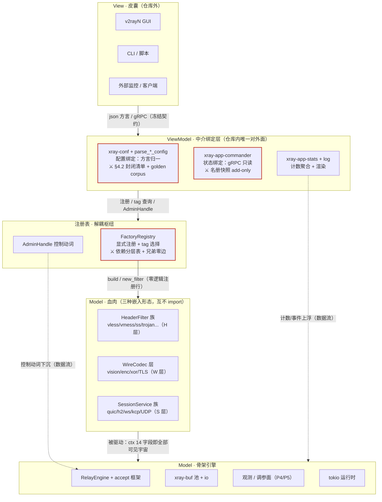

# Xray-core-rust 分层宪法（ARCHITECTURE.md）

> **效力**：治理文档。每次新增协议、每个 AI 子代理派单，先对齐本图，再动手。
> **细则不在本文**：裁决全文见 [`docs/refs/oracle-framing-arch.md`](docs/refs/oracle-framing-arch.md)（v1 裁决书）、[`docs/refs/oracle-framing-v2.md`](docs/refs/oracle-framing-v2.md)（v2：数据面 Filter/引擎）、[`docs/refs/oracle-framing-v3.md`](docs/refs/oracle-framing-v3.md)（v3：MVVM 增补）；病灶清单见 [`docs/refs/alloc-audit-report.md`](docs/refs/alloc-audit-report.md)（AllocAudit 审计）。宪法只立规矩，细则走链接。
> English version: [ARCHITECTURE.en.md](ARCHITECTURE.en.md)（主文档为中文版；英文版跟随本文件同步修订，变更记录双记）。
> **标注铁律**：【现状】= 已落地，可 grep 验证；【规划】= 裁决已定、未落地。禁止把规划写成现状，禁止给未定型 API 写文档承诺。
> **分层阅读**：每节开头紧凑表即原 138 行审定版（TL;DR 层），`详细` 小节为展开层。只对齐图景读 TL;DR 层即可；动手开发新协议必须读完 §3 详细 recipe——本宪法按「未参与决策会话的开发者只读本文即可正确开发」标准书写。

## 0. TL;DR——MVVM 五层全景图

### 0.1 三层隐喻与依赖方向

项目所有者隐喻：**骨架 = GameFrameWork**（内存分配调度、线程管理、资源回收，框架托管）；**血肉 = 协议和 DNS**（只管协议逻辑开发）；**皮囊 = V2rayN 等客户端**（对接层）。

> 实线=依赖（单向向下，View→VM→注册表→血肉→骨架，永不反向）；虚线=数据流（计数上浮、控制下沉）。⚔ = 机械化检查点。（v3 §4 全景图原样迁入）



读法三句（v3 §4）：**依赖只向下**（View 永远不知道 Model 存在；血肉永远不知道 commander 存在）；**三处 ⚔ 是全部纪律的执法点**（配置快照、名册快照、依赖分层表——三份 CI 检查管住整个 MVVM）；**血肉可见宇宙 = ConnCtx 冻结字段（14+1，§6.4）+ 注册表**，除此之外的一切不可见即不可用。

依赖方向：View → ViewModel → 注册表 → 血肉 → 骨架，严格单向。
血肉不 import ViewModel（commander/stats/conf）；协议不绕过骨架自建缓冲/调度/accept/统计。

血肉范围：17 个 `xray-proxy-*` + 各 transport 的协议语义部分 + `xray-app-dns` 及 app 模块中承载协议逻辑的部分（其托管面——连接、缓冲、调度——仍归骨架）。
皮囊范围：cli 装配、配置形态兼容、commander API。

引擎类比的取舍：**抄「资源托管 + 填钩子」，不抄「中央帧循环 / 运行时接管 / 完全隐藏内存」**。

### 0.2 骨架子件一览

| 骨架子件 | 状态 |
|---|---|
| 调度引擎 | 【现状】tokio 即调度引擎：spawn/IO/定时器全托管；无 executor 包装层（永不建） |
| 缓冲与池 | 【现状】xray-buf 11 模块逐文件镜像 Go `common/buf`；两级分层池（TLS 缓存 + 8 分片全局，2K/8K/32K/128K）；`Buffer` `#[must_use]` + Drop 回池；`copy_with_options` = Go `buf.Copy` 直译。【规划】`Bytes` 零拷贝入口 `Buffer::from_bytes_frozen`；io.rs Reader/Writer 去 box（poll-based + 具名 future 默认方法；连接边界 `BoxedReader` 每连接 1 box） |
| transport 抽象 | 【现状】`xray-transport-*` crate 族；security（tls/reality）包装在独立 crate，防依赖环 |
| dispatcher | 【现状】DefaultDispatcher + 装饰链（SizeStat/Cached/EndpointOverride）+ splice 准入闸（Go `CanSpliceCopy` 1/2/3 语义）。【规划】装饰链 poll 直通：每层 1 box → 0 分配 |
| 连接引擎 | 【规划·P2.5（v2）】RelayEngine = DialBridge 泛化：统一 5 处分裂泵；RelayFilter 三回调（poll_decode/poll_encode/on_event）；首迁 vmess inbound |
| 注册表 | 【规划·P2.0（v3）】FactoryRegistry 显式注册 + config tag 选择：outbound/inbound 中央 match 臂退化为零逻辑注册行，臂内构造逻辑随臂回血肉（BuildCtx 显式化环境依赖） |
| 统一 accept | 【现状】各 transport 手写循环 + 点状 4s timeout（httpupgrade/websocket 各自手抄）；串行 accept 残留（慢 ClientHello 占 accept 位）；httpupgrade 的 PROXY protocol 读取在超时窗外。【规划】`accept_loop` + `AcceptLimits` + `StreamHandshake` 泛型握手回调（单态化零 box）；QUIC/UDP 另立薄模板，不强统一。**【2026-10-23 PM 裁决：本行【规划】部分作废——accept 框架不落 xray-frame（P1-3 作废），见 §1.2 注记】** |
| 观测 | 【现状】stats 计数 + debug log，薄。【规划】per-stage 原子计数 + 定期 tracing（accept 速率/握手延迟直方图/超时数/active conns）、relay 积压水位；不引 metrics 框架 |
| 调参面 | 【现状】窗口/超时为硬编码常量（88m0 收窗钉、enc8x h2 窗钉两次战役均需改码→CI→换核，约 4 小时一轮）。【规划】常量进配置：TCP SO_RCVBUF 缺省、h2 STREAM_WINDOW/max_send_buf、hyper send_buf、bridge idle（300s/1s）、握手 timeout |

### 0.3 详细——新协议可复用件清单（先 grep 此清单，再动手）

**写任何自建轮子之前先对这张单**——骨架已有的件，血肉不得自建（§1.1 义务边界的正向清单）：

| 类别 | 现有件（crate 名均实测） | 复用方式 |
|---|---|---|
| 传输（9 个） | `xray-transport-{tcp,websocket,httpupgrade,splithttp,grpc,kcp,quic,hysteria,naive}`（+ 本体 `xray-transport` 内含 bridge/record_framer/finalmask/mkcp） | 经 `streamSettings.network` 选择，协议层不自写拨号/监听 |
| security 包装 | `xray-tls` / `xray-reality`（独立 crate，inbound/outbound 对称检查） | 经 `streamSettings.security`，不进协议 crate（防依赖环） |
| 数据面辅助 | `xray-mux`（mux）、`xray-xudp`（UDP 会话）、`xray-crypto`、`xray-geodata` | mux 经 `mux.json` 开启；UDP 走 UdpDispatchSession + XUDP 帧约定 |
| app 控制面 | router / dns / stats / log / policy / metrics / observatory / reverse / geodata / version / proxyman / commander | 经配置装配注入，协议层不直连 |

### 0.4 文档冲突裁决顺序

本文（宪法）> `docs/refs/` 四份治理输入（v1/v2/v3 裁决书 + 分配审计的细则）> 记忆库教训（可能过时）。**任何文档与代码冲突时，以代码为准**——文档错则修文档；疑似代码 bug（文档描述才合理）只报告不改码。本宪法的【现状】条目全部带锚点，引用前先验锚点。

## 1. 骨架承诺清单

### 1.1 TL;DR

血肉**可以拿到**（承诺；缺了即骨架的 bug）：

| 承诺 | 内容 |
|---|---|
| pooled buffer | 池化句柄自动回池（`#[must_use]` + Drop）；【规划】外部 `Bytes` 无拷贝进入管道的路 |
| accept 托管 | 连接生命周期、并发上限、握手全程超时、close/abort——协议只填握手回调 |
| 调度托管 | 线程、定时器、连接泵、半关闭窗口；协议不 spawn 线程、不自管超时轮询 |
| 观测 | per-stage 计数与错误计数挂点；【规划】gauge/积压水位 |
| 热调参 | 【规划】窗口/超时改配置不改码、不换核 |
| 日志规范 | 错误统一分类与计数，问题可从日志定位到 stage |
| 逃生舱 | splice 准入闸、readv opt-in 是一等公民，各自挂 benchmark；不许在「统一抽象」时顺手删除 |

血肉**永远不自己造**（义务边界）：① 不裸堆分配进热路径（clippy 红线，见 §6）；② 不手写 accept 循环、不自带超时/限流（现存点状 4s 补丁是债务不是范式）；③ 不 spawn 线程、不包装 executor；④ 不绕过 dispatcher 自建统计/日志通道；⑤ 不自定窗口/超时常量（用骨架默认，特殊需求走配置面【规划】）。

**血肉可见五件套（v3 §7.4：§1 承诺的最终形态，正面清单冻结）**：

| # | 门面 | 入口 | 对应承诺 |
|---|---|---|---|
| 1 | 日志门面 | `ctx.event(level, msg, fields)`——引擎 accept 时建 span，conn_id/stage/inbound_tag/target/email 自动携带；对端断开不是 ERROR（级别跟 RelayError 分类走） | P6 |
| 2 | 事件管理器 | 生命周期=引擎预布线（血肉零动作）；S 层可 `ctx.subscribe_mgmt()` 订阅热更 | P8（§1.3） |
| 3 | buffer 池 | `ctx.alloc()` / `ctx.scratch()` | P1 |
| 4 | 受监督调度 | `ctx.spawn_supervised(name, fut)`——会话表登记、终局回收（s9/s10 泄漏类封死） | P3 |
| 5 | 热调参读取 | `ctx.tuning() -> &TuningSnapshot`——只读快照+generation；写路径归 AdminHandle | P5 |

**五件之外皆禁**：tokio 直用（S 层白名单例外不变）、socket、log 宏、自建 channel、全局 static、自解析配置。负面清单的执法见 §6.4 clippy 三件套；正面清单的价值：血肉开发者只知道五件套就够写协议——骨架对血肉，如同 ViewModel 对 View，是稳定接口。

### 1.2 详细——承诺三件套（现状锚点 + 规划草图 + 验收判据）

**P1 承诺：pooled buffer。**
- 现状锚点：`crates/xray-buf/src/alloc.rs:21-40`（DEFAULT_SIZE 8192；TIER_SIZES [2048,8192,32768,131072]；TLS 缓存每层 8 块；全局 8 分片每片每层 64 块上限；60s 惰性收缩模拟 Go sync.Pool GC 节奏）；`buffer.rs:35`（`Buffer::new()` 走池）、`buffer.rs:60-63`（`from_vec` 拷贝构造——零拷贝缺口正身）、`buffer.rs:372`（`release()`）、`buffer.rs:388-396`（`impl Drop` 回池）；`io.rs:76-93`（Reader/Writer trait，`Pin<Box<dyn Future>>` 每调用装箱——box 税正身）。
- 规划草图（oracle 裁决书 §2.2 原样转述）：

```rust
// 【规划·P1】零拷贝入口：Go ownership enum 只读形态的 Rust 回归
impl Buffer {
    /// 持有外部 Bytes（零拷贝，只读语义，Drop 不回池）
    pub fn from_bytes_frozen(data: Bytes) -> Self;
}
// 内部形态从 BytesMut 变为 enum { Frozen(Bytes) | Pooled(BytesMut) }，
// iter()/as_ref() 分支读——每 chunk 一次分支，换"API 有路，纪律才有意义"。

// 【规划·P1】io.rs 去 box：poll-based trait + 具名 future 人体工学
pub trait Reader: Send {
    fn poll_read_multi_buffer(&mut self, cx: &mut Context<'_>)
        -> Poll<Result<MultiBuffer>>;
    fn read_multi_buffer(&mut self) -> ReadMultiBuffer<'_, Self>
        where Self: Sized { /* 具名 future，泛型路径零 box */ }
}
// 装饰层 poll 直通 = 每层 0 分配；连接边界 BoxedReader 适配器 = 每连接 1 box，仅此一处。
```

- 验收判据：计数分配器证明 hyper `Bytes` → MultiBuffer → relay 全程 0 拷贝；loopback 矩阵 ≥ 基线 154-167MB/s；装饰链 alloc/MB 下降可读数。

**P2 承诺：accept 托管。**
> **2026-10-23 PM 裁决（P1-3 作废）**：accept 框架（`AcceptLimits`/`StreamHandshake`/`accept_loop`）**不落 xray-frame**（三符号全仓零定义，下方草图仅为历史裁决输入）；accept 面只保留 `xray-transport::accept_policy`（错误分级 + 退避）——网络方向件留主仓（CLAUDE.md §3.5.3）。
- 现状锚点：`xray-transport-httpupgrade/src/register.rs:100-151`（串行循环逐 conn await）、`:111-114`（PROXY protocol 读取在超时窗外——残留 P0）、`:123-150`（点状 4s）、`:98-100,205-208`（abort_handle 模式=框架生命周期雏形）；`xray-transport-websocket/src/server.rs:119-125`（同型 4s）。
- 规划草图（oracle §3.2 原样转述）：

```rust
// 【规划·P2】
pub struct AcceptLimits {
    pub handshake_timeout: Duration, // 默认 4s，可配（P3 进配置）
    pub max_pending: usize,          // 信号量上限，防慢速攻击占位
    pub max_conns: usize,            // 总并发水位
}
pub trait StreamHandshake: Send + Sync + 'static {
    type Conn: Connection;
    type Fut: Future<Output = io::Result<Self::Conn>>;
    /// 一次性收到裸 TCP（框架不做任何读），PROXY/TLS/upgrade 全在实现内
    fn handshake(&self, stream: TcpStream, remote: SocketAddr) -> Self::Fut;
}
pub fn accept_loop<H: StreamHandshake>(listener: TcpListener, hs: H, limits: AcceptLimits);
// 循环体：accept → semaphore.acquire() → tokio::spawn(timeout(limits, hs.handshake(..)))
// 泛型单态化零 box（回调走 type Fut 关联类型，不走 Arc<dyn Fn -> BoxFuture>）。
```

- 边界表：进框架 = accept 循环与并发上限/握手全程超时/per-stage 计数/close-abort 生命周期/慢速攻击套件；留在 transport = PROXY 解析、TLS accept（REALITY 判定、ForceEd25519、keyshare）、ALPN 路由、HTTP upgrade 语义、cert 选择、一切协议语义。QUIC/UDP 不进同一 trait（quinn 两级 accept 语义不同，强行统一=第二个 proxyman），复用 limits+观测 helper 薄模板。逃生舱：特殊 accept 需求（如 grpc h2 serve）可绕过 accept_loop 直持 listener——框架不垄断 listener，只提供默认正确。
- 验收判据：超时/信号量/close-abort 单测；slowloris 占满 max_pending 时新连接延迟上升而非饿死、超时后 permit 释放；`grep -r "listener.accept" crates/` 仅剩框架与 QUIC 模板。

**P3 承诺：调度托管。**
- 现状锚点：tokio runtime 全局托管（spawn/IO/定时器）；连接泵范式沉淀于 `xray-transport/src/bridge.rs`（池化泵 copy_pooled + 两对 watch channel 半关闭，见 §2 坑 9）；ActivityTimer 每轮 `sleep_until` 重建（vy0 教训，见 §2 坑 5）。UDP 托管：UdpDispatchSession（xray-app-dispatcher）+ XUDP 帧约定——inbound per-client assoc + 60s idle，outbound 经 dial_fn 的 UDP 分支 Connection 包装；协议侧只做 packet 编解码。
- 规划：无新增（tokio 即终态）；只禁止反模式（血肉 spawn 线程/自包装 executor/自管超时轮询）。
- 验收判据：新协议 PR 中不出现 `std::thread`、`tokio::runtime::Builder`、裸 `tokio::spawn` 的超时轮询循环。

**P4 承诺：观测。**
- 现状锚点：dispatcher 装饰链 SizeStatReader/Writer（`xray-app-dispatcher/src/stats.rs:33-42`）做流量计数；错误分类 `xray-buf/src/io.rs:60-66`（`classify_io_error` → Read/Write/Interrupted 分类）；其余仅 debug log。
- 规划草图：每 transport/stage 原子计数器（accept 速率、握手延迟直方图、超时数、active conns）+ 定期 tracing 输出；relay 积压水位（channel 深度）+ per-tag 错误计数。不引 metrics 框架——观测面薄的原因是没埋点，不是缺 Prometheus。
- 验收判据：人为制造 2087 型挂死（半开连接钉死），告警/日志 <1min 暴露；flood 测试下 inbound 存活且观测数字与测试断言联动。

**P5 承诺：热调参。**
- 现状锚点（税单）：88m0——TCP SO_RCVBUF 收窗出生钉 ~64KB → 433KB/s 锁步（修于 3e755458，sockopt 显式配置优先）；enc8x——h2 STREAM_WINDOW/send_buf 窗钉 2.7/8.8/6.9MB/s 三组闭环（修于 transport.rs:233 max_send_buf 16MB）；每次调参 = 改码→CI→换核 ~4 小时。
- 规划清单：TCP SO_RCVBUF 缺省、h2 STREAM_WINDOW/conn 窗/max_send_buf、hyper send_buf、bridge idle（300s/1s）、握手 timeout（4s）→ 全部进配置。
- 验收判据：一次真实参数调优全程不触碰 cargo；enc8x 闭环数字（16MB 窗 @0.3s RTT 40-60MB/s）用配置复现一次。

**P6 承诺：日志规范。**
- 现状锚点：`io.rs:60-66` 错误三分类；各协议 `Err(String)` 链路带上下文。
- 规划：错误分类计数挂观测（P4）；挂死类故障从发现到定位 <5 分钟（对照 2087 挂 5 小时）。
- 验收判据：演练一次（§5 T3.3）。

**P7 承诺：逃生舱。**
- 现状锚点：splice 准入闸 `xray-app-dispatcher/src/default.rs:1768-1783`（Go `CanSpliceCopy` 1/2/3 语义）；readv 保持 opt-in（a07041ae 实测真网 -25%——批量化不是免费午餐）。
- 规划：无——保留现状即承诺；任何「统一抽象」不得顺手删除，各自挂 benchmark。
- 验收判据：readv_perf.rs 级 micro-bench 存续；splice 闸语义与 Go 对齐（PR porting note 覆盖）。

### 1.3 详细——事件管理器（P8 承诺，v3 §7 追加裁决）

**形态红线：预布线 + 规范封装，不做总线。总量预算 ≈ 1 个文件 ~200 行**（`ConnEventRecord` + `LifecycleTap`（有界 mpsc）+ `MgmtWatch`（watch channel）+ 一个 drain task）——超体量或出现「主题注册」字样即已越界成总线框架，砍回预布线形态。

| 类 | 事件 | 通道裁决 | 背压语义 |
|---|---|---|---|
| T1 连接生命周期 | accept / 握手完成 / 半关闭 / 关闭（原因走 RelayError 分类） | 引擎**同步直调** filter（热路径零间接）；连接外观察者=启动期显式注册 `LifecycleTap`（有界 mpsc + 单 drain task），运行时不开放订阅。RelayFilter 不经此 | 满即丢 + 自计数 `events_dropped{tap}`，**永不反压数据泵** |
| T2 进程管理 | 配置热更（窗口/超时新值+generation）、shutdown、stats tick | `tokio::sync::watch`（最新值胜出、天然有损）；broadcast（无回放需求）/mpsc（多订阅者要中心路由）否决 | watch 无背压问题（读端永远拿最新） |
| T3 数据面告警 | 水位告警 / 限速触发 / rekey | **不设新通道**：量级→counter、离散→`ctx.event` 日志、连接内控制→既有 ctx 方法（`set_idle`/PauseRead） | — |

- 背压三铁律：一切观察者通道**有界**；满即丢+自计数，**绝不阻塞泵**（观测不可税——splice 双 revert 教训的推广）；丢弃本身可观测（`events_dropped` 上浮告警）。慢订阅者修法=批量 drain 聚合，不是加缓冲。
- **单一真相规则**：`on_event` 是引擎对 filter 的同步直调（连接内控制流），不是事件管理器的订阅者——一源两汇：filter 同步收到（必须快），T1 tap 异步收到轻量 `ConnEventRecord`（Copy，无 payload）。计数是第一真相（原子加，不可丢），事件是时间线补充（可丢，服务诊断）；stats **永不依赖事件消费来聚合**（事件丢弃不得污染计数）。
- 选型总原则：**控制流不坐事件通道**——dial 完成、半关闭决策、错误处理都是引擎同步直调；通道丢事件只损失诊断信息，不损失正确性。
- 落点：T1 预布线随 **P2.5 引擎**同批（引擎本来就在半关闭/关闭处发通知，顺手接 tap）；T2 watch 随 **P3 热调参**落地（配置热更的载体）；首批观察者=observatory、online-ip、admin 活跃连接表（隐式计数改造为显式订阅）。
- 血肉自定义事件：**YAGNI 否决**（现状零场景 + 事件枚举类型归属悖论，v3 §7.5；再议须三判据全满足走 RFC）。血肉想「发布」什么→ `ctx.event`（日志时间线）或 counter（量级）——观测语义，两口都在五件套内。

## 2. 框架吃掉的 Rust 坑清单

### 2.1 TL;DR

本节是 §1 义务边界的反面论证：**Rust 容易踩的坑必须由框架吃掉，血肉（协议）作者踩不到**。每收口一条，血肉作者的坑表就短一截；本表同时是 P1/P2 的验收对照（收口判定 = 所有「现状：是」翻成「否」）。

> **2026-10-23 PM 裁决（P1-3 作废）**：accept 框架（`AcceptLimits`/`StreamHandshake`/`accept_loop`）不落 xray-frame——坑 1/2/8 的【规划】机制接口栏随裁决失效（**现状栏仍准**）；accept 面只保留 `xray-transport::accept_policy`（错误分级 + 退避）。

| # | 坑（事故史） | 框架吃掉机制 | 血肉作者还会遇到吗 |
|---|---|---|---|
| 1 | accept 循环串行握手无超时——半个 ClientHello 堵死整个 inbound（httpupgrade P0：生产 2087 挂 5 小时；websocket 同型复发） | 统一 accept：超时 + 并发接纳（spawn + 信号量 + AcceptLimits）【规划 P2；现状 = 点状 4s 补丁，PROXY 读取段仍在超时窗外】 | 现状：是（点状不全）；P2 后：否 |
| 2 | handler 被 move 进 spawn future 后 drop → listener 关闭、连接全拒（anytls 入站接线缺陷） | accept 框架持有生命周期（close/abort 归框架）【规划 P2】 | 现状：靠人肉保活；P2 后：否 |
| 3 | 池化 buffer 忘 resize → tokio read 空 buf 返回 Ok(0) 假 EOF（xray-buf alloc 返回 len=0 的铁律坑） | buffer 句柄出厂即合法：resize 内建于构造，Drop 回池语义不变【规划】 | 现状：是（铁律靠人肉记）；收口后：否 |
| 4 | 每帧 `Vec::new` / poll_write_vectored 每帧拷贝 → 协议吞吐钉死 3.3–3.8MB/s（vision 病，bd vscd） | 零拷贝管道默认 + 池句柄；API 不给需要 `to_vec` 的场景（【规划】`from_bytes_frozen`） | 现状：主体已修仍靠纪律；P1 后：否 |
| 5 | tokio Sleep `reset()`→`set()` 改名 + Pin 方法解析歧义（ActivityTimer，vy0） | 框架 idle-timeout 组件：每轮 `sleep_until` 重建；血肉不直接摸 Sleep | 现状：基本否（范式已沉淀于框架组件） |
| 6 | quinn `open_bi` 惰性：首 write 才发 STREAM，不写对端 `accept_bi` 永不返回（V-Batch1-6op） | QUIC/UDP 薄模板内建首包/双级 accept 语义【规划 P2】 | 现状：自写 quinn 会踩；P2 后：否 |
| 7 | Reader/Writer trait 每调用装箱 `Pin<Box<dyn Future>>`、装饰链逐层放大（xi40；io.rs:76-93 正身） | poll-based trait + 具名 future 默认方法；血肉拿到的 API 天然零 box【规划 P1】 | 现状：是；P1 后：否 |
| 8 | Go `SetReadDeadline` 语义在 Rust 无对应 → TLS 惰性握手裸奔（本两次 P0 的根因） | 框架 deadline 语义全覆盖，含 PROXY protocol 读取段【规划 P2；现状 = 点状 4s】 | 现状：是（段覆盖不全）；P2 后：否 |
| 9 | spawn 任务无 shutdown 传播 → 资源泄漏/连接僵死（bridge 两对 watch channel 的血泪） | 框架统一 abort/生命周期【规划 P2】+ bridge 泵半关闭范式（up/down_done 双 watch）已沉淀 | 复用骨架 bridge 泵：否；P2 统一收口 |

### 2.2 详细——每条坑的复现要点与机制接口形态

1. **串行 accept 占位**。触发形态：`loop { let (s, _) = listener.accept().await?; handshake(s).await?; }`——握手 await 在 accept 循环体内且无 timeout。攻击者每 4s 递半个 ClientHello，接纳率 ~0.25/s；`acceptProxyProtocol: true` 时 PROXY 头读取连 4s 都没有（register.rs:111-114）。机制接口：§1.2 的 `accept_loop`+`AcceptLimits`——spawn+信号量使慢握手只占 permit 不占 accept 位。
2. **handler move 后 drop**。触发形态：`tokio::spawn(async move { handler.serve().await })` 中 handler 未被 listener 结构体持有（或持有方先 drop）→ 关联 listener 关闭。anytls 修法（start() 外移 + pending 保活）是点状人肉版；机制接口：`accept_loop` 持有 `H: StreamHandshake` 与 abort_handle（httpupgrade register.rs:98-100/205-208 模式收编）。
3. **池化 buffer 假 EOF**。触发形态：`let mut b = alloc::alloc(8192); let n = stream.read(&mut b).await?;`——alloc 返回 len=0，tokio read 空 buf 返回 `Ok(0)`，被当 EOF。现状铁律：alloc 后必须 `resize(size, 0)`。规划机制：`Buffer` 构造出厂即合法（resize 内建），`#[must_use]`+Drop 回池不变（buffer.rs:388）。
4. **每帧分配钉死吞吐**。触发形态：编解码每帧 `Vec::new()`/`to_vec()` 进写路径；`poll_write_vectored` 逐帧小 iovec（vision：xtls_padding 每帧 Vec::new + 每帧 3 拷贝 → 三协议恒 3.3-3.8MB/s 挂数月）。判别法（enc8x 方法论）：**吞吐数字 ÷ RTT 反推在途上限，与已知窗口/缓冲常数对照**——「吞吐恒定不随 regime 摆动」= 窗钉/缓冲钉；「分钟级摆动」= 路径 regime。机制接口：池句柄 caller-scratch（vision.rs:149-201 修后形态）+【规划】`from_bytes_frozen`；API 面不提供需要 `to_vec` 的场景（数据路径收 `Bytes`/池句柄，不收 `&mut Vec<u8>` 让调用者先拷一份）。
5. **Sleep reset/set 陷阱**。触发形态：`Pin<&mut Sleep>` 上调 `.set()` 解析到 `Pin::set` 而非 `Sleep::set`；tokio 新版把 `reset()` 改名 `set()`。机制接口：框架 idle-timeout 组件内部每轮 `tokio::time::sleep_until(Instant::now() + timeout)` 重建（cancel-safe，ActivityTimer 现行形态）；血肉拿 idle-timeout 组件，不 import `tokio::time::Sleep`。
6. **quinn open_bi 惰性**。触发形态：`let (mut tx, rx) = endpoint.open_bi().await?; let _ = peer.accept_bi().await?;`——`open_bi` 是 lazy，首 write 才发 STREAM 帧，不写对端 `accept_bi` 永不 pending-ready（e2e 里表现为 ~30s idle timeout 才浮出拒绝）。机制接口：QUIC/UDP 薄模板内建「连接建立即首发」语义【规划 P2】；现状由各 QUIC 协议自处理（hysteria/tuic 已踩平，新协议照抄其 client.rs 首发）。
7. **trait 装箱全链放大**。触发形态：新增装饰 Reader 时实现 `read_multi_buffer` 并 `Box::pin` 内层 future——每层装饰 × 每次 read × 1 次堆分配；dispatcher 装饰链三层即三倍（stats.rs:33-42、default.rs:1527-1544 CachedReader、endpoint_override.rs:89）。机制接口：【规划 P1】poll 直通（装饰层同步转发内层 poll）；过渡期纪律：不加新装饰层、不加新 `Box::pin`。
8. **deadline 语义缺失**。触发形态：`TlsAcceptor::accept(stream)` 无外层 timeout——TLS 惰性握手等 ClientHello 无限期；Go 侧 `SetReadDeadline` 是惯用防护，Rust 无对应惯用式。机制接口：【现状】每 transport 手包 4s（httpupgrade register.rs:123-150 / ws server.rs:119-125，对齐 Go hub.go:143）；【规划 P2】`accept_loop` 的 `handshake_timeout` 一处覆盖全段（含 PROXY 读取）。
9. **shutdown 不传播**。触发形态：`tokio::spawn(pump(ra, wb))` 两泵无共享取消信号——一端关闭后另一端按 idle timeout（300s）才退，fd/内存滞留（s5-s12 压测三泄漏的场景基础）。机制接口：骨架 bridge 泵范式已沉淀（`xray-transport/src/bridge.rs`：up/down_done 两对 watch channel + 双模式读循环——无连接 300s idle、半关闭窗口 1s，Buffer 512KiB 对齐 Go）；新协议 relay 一律复用，不自写泵。【规划 P2】accept abort 再统一收口。

## 3. 血肉配方：新协议接入 recipe

### 3.1 TL;DR

接入一个新协议 = 只做两件事，其余托管：

1. **实现编解码**：定义帧边界（线格式的帧边界 = 缓冲边界 = 窗口大小——内存决策就是协议语义），全部使用骨架缓冲句柄；
2. **填握手**：实现握手回调（【现状】期间按各 transport 现行方式；【规划】`StreamHandshake`），PROXY protocol / TLS / upgrade 语义在实现内，超时与并发归框架。

随后自动获得托管：**内存**（池句柄 Drop 回池）、**拷贝**（默认零拷贝管道）、**调度**（accept/泵/定时器）、**回收**（连接关闭统一释放）、**观测**（stage 计数）。

| # | 要求 | 设计原则 |
|---|---|---|
| ① | 轻量 | 骨架 boring/small；API 稳定靠「少而同位 Go」，不靠版本承诺；不加没人要的抽象层 |
| ② | 高效 | 每 chunk 分配即税：**每连接可以 dyn，每 chunk 不许 dyn**；热路径零 `to_vec`；批量优化（readv）保持 opt-in，且必须真实端点同窗 A/B |
| ③ | 容易拓展 | 新协议 = 编解码 + 握手回调两件事；recipe 是唯一合法接入方式 |
| ④ | 内存和线程管理优秀 | 分配走池、线程归 tokio；协议代码里不出现线程与裸分配 |
| ⑤ | 接入非常简单 | recipe 验收 = 从零实现 trivial 协议端到端跑通（Phase 4 出口判据） |
| ⑥ | 完全不用考虑内存管理 | **诚实版本**：协议永远不写 `malloc`——不裸分配，一律池句柄或所有权转移；API 层面感觉不到（handle 自动回池、零拷贝管道默认）。但线格式协议的内存布局决策就是协议语义，协议**必须理解所有权转移**（帧从哪里来、freeze 后归谁、何时回池）——框架藏掉写法，藏不掉理解 |
| ⑦ | 连深浅拷贝都不用管 | 默认路径零拷贝（`Bytes` 入口、scratch 字段化、vectored 直写）；任何一处显式拷贝都是决策，须有 A/B 数字或注释说明理由 |
| ⑧ | log 报错规范 | 错误统一分类计数；挂死类故障从发现到定位 <5 分钟（对照现状约 5 小时） |

### 3.2 Step 0——动手前：grep Go 基线（铁律）

本项目 issue 前提错误率 20+/22，铁律：**每个协议语义（帧格式/握手序列/超时/加密协商）动手前先 grep Go 基线 `D:/Project/Xray-core` 验证**，_bd 票面按字节级描述预期 wire 行为_。Go 上游加一个协议动哪些文件（先例，已 glob 实证）：

```text
proxy/<name>/            <name>.go（公共类型/validator）+ config.proto/config.pb.go/config.go
  ├─ inbound/            inbound.go + config.*
  ├─ outbound/           outbound.go + config.*
  ├─ encoding/           encoding.go（帧编解码，可选）
  └─ account/            account.proto（vless/vmess/hysteria 等带账号的）
infra/conf/<name>.go     JSON 配置序列化（protocolKey → settings 解析）
app/proxyman/…           （如需 API 面）
```

Rust 侧同位物：`crates/xray-proxy-<name>/`（协议体）+ `crates/xray-conf/src/protocols.rs`（配置解析）+ `crates/xray-core/src/{inbound,outbound}.rs`（注册臂）。镜像式框架化让 diff 变小：**协议语义 1:1 移植，不自创范式**。

### 3.3 Step 1——建 crate（目录清单）

以 `xray-proxy-tuic` 为样板（实测文件树）：

```text
crates/xray-proxy-mock/
  Cargo.toml            # 依赖：xray-buf / xray-common / xray-features；带 TLS 时加 xray-tls
  src/lib.rs            # 导出：Handler 构造、parse_mock_config、DialFn 工厂
  src/config.rs         # parse_mock_config(&[u8])——Go infra/conf 的同位物；双形态兼容在这里做（§4.2）
  src/protocol/         # 帧编解码（纯函数，缓冲规则见 Step 3）
  src/outbound.rs       # 独立 Handler（测试装配路径）
  src/dispatcher.rs     # make_mock_dial_fn() → 生产 DialFn（对应 tuic dispatcher.rs:106 make_dial_fn）
  src/inbound.rs        # 入站 handler + listener 接线（见 Step 5）
  src/error.rs          # 错误分类（对齐 io.rs:60 classify_io_error 分类法）
  tests/                # loopback / dispatch 集成测试（见 Step 6）
```

命名与依赖红线：security 包装（tls/reality）不进协议 crate（防依赖环，transport security 在独立 crate 的架构定型）；协议 crate 不依赖 `xray-core`（方向：core → proxy，不可反向）。

### 3.4 Step 2——配置解析与注册点（全清单）

新增协议必触的注册点（现状锚点，grep 可验）：

1. `crates/xray-conf/src/protocols.rs`：`parse_mock_config`——settings JSON（bytes）→ 协议配置 struct。双形态兼容（v2rayN 裸字段 vs Go 数组）在此归一（SS 先例 d0555c26：入口 first 分支两形态映射同一引用，后续逻辑零改动）。
2. `crates/xray-core/src/outbound.rs:672` `match ob.entry.kind.as_str()`：加 `"mock" =>` 臂。臂内三件事（对照 :910 tuic 臂）：`parse_mock_config(&ob.entry.data)` → `.with_stream_settings(parse_stream_settings(&ob.stream_settings_json))`（:751-754 vless 臂形态）→ 构造 handler。生产路径统一经 `try_build_handler`（outbound.rs:543）——**独立 Handler 只是测试用，生产可用性以 try_build_handler 臂为准**。
3. `crates/xray-core/src/inbound.rs:2687` `match ib.entry.kind.as_str()`：加 `"mock" =>` 臂（`spawn_one_inbound`，inbound.rs:2625；对照 :2718 vless 臂：validator 构建 + listener bind + dispatch 接线）。
4. 透传语义不用自己做：`streamSettings/sniffing/mux/proxySettings` 子对象由 xray-conf 原样透传（`built.rs:56-74` `stream_settings_json: Option<Value>`）；明文出站禁令自动生效（`outbound_security.rs:116`，vless encryption=none / trojan 无 TLS 且非私网目标硬错——新协议若属明文族，对齐该函数的分类）。
5. 【按需】commander/proxyman API 面暴露：`xray-proto` 加消息（对应 Go config.proto）。

配置 JSON 形态示意（mock 出站，双形态——与 §4.2 承诺同构）：

```json
// Go 形态（servers 数组）：
{"protocol": "mock", "settings": {"servers": [{"address": "h", "port": 443, "token": "t"}]},
 "streamSettings": {"network": "tcp", "security": "tls", "tlsSettings": {"serverName": "h"}}}
// v2rayN 形态（裸字段，若有用户实锤再承诺兼容）：
{"protocol": "mock", "settings": {"address": "h", "port": 443, "token": "t"}}
```

双形态归一写法（d0555c26 先例）：解析入口处 `first` 一次分支——数组形态取 `servers[0]`、裸字段取自身——两分支映射到**同一个** `first` 引用，后续字段解析逻辑零改动、零重复。

### 3.5 Step 3——编解码的缓冲规则（骨架义务的行格式）

- 帧读：`Reader::read_multi_buffer` 拿 `MultiBuffer`【现状 io.rs:76-93 boxed future；【规划 P1】poll trait，新代码按 poll 形态写，避免新增 Box::pin】。
- 帧写：池化 `Buffer` 直写 + `write_multi_buffer`；外部来源的 hyper/h2 `Bytes`【现状】只能拷入（`from_vec` buffer.rs:60 拷贝构造）——这是已登记债务 F1/F3；【规划 P1】后走 `from_bytes_frozen` 零拷贝。
- 禁止清单：热路径 `to_vec()`/每帧 `Vec::new()`/`BytesMut::new()` 不 resize 直接 read（§2 坑 3）/整流缓冲式 API（vmess whole-body 教训 F14：生产 pump 全部 `next_ref()`+持久 chunk_buf，整流拼接=延迟+内存陷阱，勿接入生产流）。
- 需要写时拷贝的场景（split 后仍要 append）：走池化路径；只读共享（转发不改）走【规划】Frozen。
- 加解密实例：连接级构造常驻（struct 字段），数据路径仅 `open_in_place`/`seal_into` + nonce 递增；rekey 仅密钥上限时（SS-2022/REALITY 先例，common_conn.rs:196 形态）。**禁止每帧重建加密上下文**。
- 句柄用法示意（caller-scratch 形态，vision.rs:149-201 修后范式；示意，未验证——以各 crate 现行调用为准）：

```rust
// 编码：调用方提供 out（跨帧复用的池句柄/scratch），编码器只写入不分配
fn encode_frame(out: &mut Buffer, payload: &[u8]) -> Result<()> {
    out.write_u16(payload.len() as u16)?;   // 长度前缀直写池句柄
    out.extend_from_slice(payload);         // 单次拷贝进句柄，无中间 Vec
    Ok(())
}
// 解码：从 MultiBuffer 剥一帧；半包返回 None（数据留在原处待续读），不拷不拼接
fn decode_frame(src: &mut MultiBuffer) -> Result<Option<Buffer>> { /* split_to 语义 */ }
```

### 3.6 Step 4——outbound 生产接线（两套路径）

生产：`dispatcher.rs` 提供 `make_mock_dial_fn(client: Arc<MockClient>) -> DialFn`（对照 `xray-proxy-tuic/src/dispatcher.rs:106`：连接级副作用——心跳启动、惰性地址解析（:136 `make_dial_fn_lazy`，真实节点 address 是域名）——放工厂内一次性执行；返回的闭包内 clone Arc + 按 dest 建 session，不在闭包里做每调用重活）。`try_build_handler` 臂调它装配（xray-core outbound.rs:672 match）。UDP：走 UdpDispatchSession + XUDP 帧约定（xray-app-dispatcher 架构定型），协议侧只提供 packet 编解码。
测试：独立 `Handler::new(config)`（outbound.rs 路径之外）——仅供 crate 内 loopback 测试，**不得**作为可用性判据。

### 3.7 Step 5——inbound 接线与 accept

> **2026-10-23 PM 裁决（P1-3 作废）**：accept 框架（`AcceptLimits`/`StreamHandshake`/`accept_loop`）不落 xray-frame；accept 面只保留 `xray-transport::accept_policy`（错误分级 + 退避）。本节【规划 P2】`StreamHandshake` 字样随裁决作废；过渡期 4s 握手超时纪律仍有效。

固定模式（TUIC 样板，架构定型⑥）：

```text
InboundHandler::with_dispatch(Arc<dyn DispatchHandler>)   // builder 注入分发器
  → listener accept（【现状】手写循环：TLS/PROXY 握手 + 4s timeout 手包；
                     【规划 P2】实现 StreamHandshake，超时/并发归框架）
  → 预读 initial_bytes 必须经 InitialedReader（Cursor 前缀 + 透传）回灌
  → Link::new(new_reader, new_writer) + Destination::new
  → handler.dispatch(link, dest)
```

接线语义展开：`Destination` 描述客户端请求的目标（地址 + 端口，`Destination::new`）；`Link` 是 dispatcher 交付的双向管道（reader/writer 两半）；预读字节（首帧的一部分已在握手缓冲里）**必须**包成 `InitialedReader` 回灌，否则首帧头部丢失。UDP inbound 另走 UdpDispatchSession（60s idle，per-client assoc）+ XUDP 帧约定，不经 TCP Link。

【现状】过渡期纪律：手写循环必须包 4s 握手超时（对齐 Go hub.go:143）、必须注释「债务：待 P2 accept_loop 收敛」；不许裸奔无超时（§2 坑 1/8）。

### 3.8 Step 6——测试矩阵

| 层 | 要求 | 现成基建 |
|---|---|---|
| lib 单测 | 帧编解码 roundtrip + 边界（粘包/半包/错误帧）；双配置形态（§4.2）各一条 | grpc encoding.rs roundtrip 护栏先例 |
| crate 集成 | `tests/` 双 start_full 实例：server 侧 = 被测协议 inbound + freedom 出站；client 侧 = socks 入站 + 被测协议出站；echo 流量穿全链（functions.rs 内部 API）。**铁律：freedom settings 恒 `{}` 会被 inbound 默认 BlockPrivate 黑洞 127.0.0.1 echo——测试配置必须带 finalRules 回环放行，否则表现为 echo timeout 的假协议缺陷**（grpc_multimode/transport_interop/e2e known-fail 族统一根因） | tuic tests/ 五件套（loopback/dispatcher_loopback/inbound_dispatch/udp_loopback/domain_dial） |
| interop | Rust 客户端 ↔ Go 服务端 + 反向（2×2 四角齐全）；dist/interop_ci.py 加套件 | Batch15/interop 7 缺陷战役的陷阱清单：Go freedom 回环放行（finalRules allow 127.0.0.0/8，否则黑洞 40s 假死）；Go 子进程 stdout 必须后台 drain（64KiB pipe 满即假 hang）；Go BufferedWriter SetFlushNext 顺序（先 body 后读响应头）；RST 竞态（termination chunk 与 body 同 vec 一次写） |
| 共享 listener 类 | kcp 型 UDP 协议 `--test-threads=1` | kcp tests 先例 |
| 性能 | 真实端点同窗配对 A/B（同 binary 同窗交替，禁跨窗）；loopback 冒烟 ≥ 基线 95% | stress.yml / xray-stress s5-s12 / readv_perf.rs |
| CI 宽门 | clippy `--workspace --all-targets -D warnings` + `cargo doc --workspace --no-deps` + stable 工具链 fmt | ci.yml |

### 3.9 Step 7——验收 checklist（PR 自查）

- [ ] 每条协议语义有 Go 基线 file:line 对照（grep 过 `D:/Project/Xray-core`）
- [ ] 热路径零 `to_vec`/每帧分配（clippy 禁令零新增豁免）
- [ ] 无手写 accept 超时/限流（或注「债务待 P2」）；无 `std::thread`；无自建统计通道
- [ ] `try_build_handler`/`spawn_one_inbound` 注册臂齐全（生产可用，非仅测试 Handler）
- [ ] 明文出站禁价新分类已对齐（若明文族）
- [ ] 测试矩阵四层齐全；kcp 型已限并发
- [ ] PR porting note 已填（§6.5）；未转正 API 全部 `pub(crate)`/`#[doc(hidden)]`
- [ ] mock-protocol 型 trivial 协议按本 recipe 从零跑通（P4 出口判据的持续验证）

### 3.10 mock-protocol 走查示范（假设协议，示意流程非交付代码）

以「mock：长度前缀帧 + token 握手」为例的最小走查：Step 0 → grep Go 假设上游 `proxy/mock/`（无则按 spec 自证并在票面注明「无 Go 对应」）；Step 1 → 建 `crates/xray-proxy-mock/`（§3.3 树）；Step 2 → `parse_mock_config` 认 `{"token": "...", "servers":[...]}` 与 v2rayN 裸字段两形态 + 两处 match 臂；Step 3 → `protocol/frame.rs`：`fn encode_frame(dst: &mut Buffer, payload: &[u8])`（长度前缀直写池句柄，零中间 Vec）+ `fn decode_frame(src: &mut MultiBuffer) -> Result<Option<Buffer>>`（半包返回 None 待续）；Step 4 → `make_mock_dial_fn`；Step 5 → inbound `with_dispatch` 接线；Step 6 → 单测 roundtrip + 双 start_full loopback + interop 双向；Step 7 → checklist 自查。全程触碰的既有文件仅 3 个（protocols.rs / outbound.rs / inbound.rs 各加一处）——这就是「容易拓展」的量化形态。

### 3.11 详细——既有协议的范式索引（写码前先读对应范式）

| 要写的东西 | 先读哪个 crate | 学什么 |
|---|---|---|
| QUIC/UDP 协议全流程 | `xray-proxy-tuic` | DialFn 工厂（dispatcher.rs:106/136）、双 start_full 集成测试五件套、UDP loopback |
| TCP 协议 + fallback | `xray-proxy-trojan` | Validator、fallback 决策树（dest 数字/缺失对齐 Go trojan.go:151-198） |
| 加密流协议的零分配 pump | `xray-proxy-vmess` | `next_ref()` 零分配 nonce + 持久 chunk_buf + `seal_into`/`open_in_place`（生产 pump 全部此形态） |
| 配置双形态兼容 | `xray-proxy-ss` | d0555c26 裸字段/数组归一；SS-2022 rekey 仅密钥上限时 |
| QUIC 路径优化写法 | `xray-transport-hysteria` | poll_write 直通零 to_vec、Bytes::freeze owned 组包、BufPool 对齐 Go pool.Get/Put、收发 scratch 字段化 |
| TLS 流的 caller-scratch 编解码 | `xray-proxy-vless` `encryption/vision.rs:149-201` | padding out-param + padding_scratch 容量流转 + downlink 直写复用（vscd 修后范式） |
| handler 生命周期教训 | `xray-proxy-anytls` | §2 坑 2 事故现场与修法（start() 外移 + pending 保活） |
| 反面教材（待 P1 收口） | `xray-transport-splithttp` | h2/Bytes 边界 to_vec 族 F1/F2/F3/F15——新协议严禁模仿，等 `from_bytes_frozen` |

## 4. ViewModel 契约

### 4.1 TL;DR

**配置形态兼容承诺**：Go Xray-core 已定义的配置形态（含 v2rayN 混排 JSON、`streamSettings` 等历史形态）是**兼容承诺**：内部重构不得破坏既有配置解析。自创配置形态不进承诺；框架 API 永不领先 Go 改名。反面教材：proxyman 平行世界（建了即不接入）——皮囊对接一律走生产装配路径。
**commander API 边界**：commander 是皮囊对骨架/血肉的管理面入口；对外 API 变更同样受 §6 转正门槛约束；皮囊不触碰血肉内部结构。

**ViewModel 命名（v3 §2）**：仓库内的「对外面」= xray-conf + commander + stats + log 四个 crate 群 + 一条边界法，总称 **ViewModel**（View 绑定面的总和）。View 在仓库外（v2rayN/CLI），天然满足 View ⊥ Model；真正设防的是仓库内 VM↔M 边界。三契约：

| 契约 | 冻结物 | 机械化 |
|---|---|---|
| ① 配置绑定（View→Model） | §4.2 封闭清单 + 归一入口签名（每血肉 crate 恰一个公开 `parse_*_config`） | golden config corpus 快照（§4.2 末） |
| ② 状态绑定（Model→View，只读） | gRPC 端点名 / 计数名 / 日志字段名，**add-only** | 名册快照测试（§4.3 末） |
| ③ VM 自身依赖纪律 | VM 可依赖：骨架全部、注册表句柄、血肉公开 parse 入口与只读查询 trait；不可：绕过注册表点名血肉类型、在 VM 写协议语义（解析器归一化除外——那本来就是绑定工作） | 依赖分层表（§6.4） |

**组合根诚实条款**：二进制必须链接血肉 crate（物理现实：feature 门控的 dist 裁剪），允许 `use` 到**注册行**为止（`reg.outbound::<FreedomFactory>("freedom")`），禁止其他调用——**链接合法、点名构造非法**。总边界：血肉 crate 不 import commander/stats/conf 任何符号；ViewModel 不 import 血肉 Handler/Filter 类型（只经注册表拿 trait 对象）。

### 4.2 详细——v2rayN 混排形态承诺清单（逐项，锚点可验）

| # | 形态 | 锚点/出处 |
|---|---|---|
| 1 | SS 出站 settings 双形态：`servers` 数组（Go 形态）与裸字段 `address/port/method/password`（v2rayN 形态）同认，归一到同一解析 | d0555c26（「missing servers array」用户实锤修复） |
| 2 | DNS `servers` 双形态：对象数组与裸字符串同认 | dd0ae34b，对齐 Go infra/conf/dns.go:37-41；deserialize_with 逐条目分流 |
| 3 | VLESS 出站 `encryption` 为 settings 顶层 flat 字段（非 `users[].encryption`） | 对齐 Go infra/conf/vless.go:253（L301 account.Encryption 灌入） |
| 4 | `streamSettings`/`sniffing`/`mux`/`proxySettings` 子对象**原样透传**（`Option<serde_json::Value>`，不强 schema） | xray-conf/src/config.rs:157,188；built.rs:56-74 |
| 5 | 入站 `clients` 数组形态 | xray-conf/src/built.rs:463（测试断言） |
| 6 | 明文出站禁令语义：vless `encryption=none` 或 trojan 无 TLS 且目标非私网 → 启动硬错；已有 `security` 则放行 | d7fa2076，Go infra/conf/xray.go:245-266；outbound_security.rs:116-123 |
| 7 | transportLayer 代理门控：`proxySettings.tag` 与 `sockopt.dialerProxy` 同设冲突硬错；`transportLayer: true` 时 dialerProxy 注入 streamSettings | Go xray.go:248-250,316-327；built.rs:272-355（bd enk） |

边界条款：以上为**已实证形态**的封闭清单；新历史形态「发现一个、修复一个、单测钉一个」（先例 SS/DNS 两票），不预设猜测性兼容。大小写/别名等未验证形态**不在承诺内**，修复前先 grep Go 确认 Go 侧行为。

实证形态的 JSON 对照（commit 原文语义）：

```json
// #1 SS 出站双形态（d0555c26）：
{"protocol": "shadowsocks", "settings": {"servers": [{"address": "h", "port": 8388, "method": "2022-blake3-aes-128-gcm", "password": "…"}]}}   // Go 形态
{"protocol": "shadowsocks", "settings": {"address": "h", "port": 8388, "method": "2022-blake3-aes-128-gcm", "password": "…"}}                  // v2rayN 裸字段
// #2 DNS servers 双形态（dd0ae34b，Go dns.go:37-41）：
{"dns": {"servers": [{"address": "8.8.8.8"}, {"address": "1.1.1.1"}]}}   // 对象数组
{"dns": {"servers": ["8.8.8.8", "1.1.1.1"]}}                              // 裸字符串
```

**v3 制度化（配置绑定契约的保障机制）**：① **golden config corpus（金样本快照）**——仓库存一组真实 v2rayN 导出配置为 fixture（§4.2 已实证形态各一条 + SS-2022 实锤样本即首批），每条断言 `parse → 归一化结构 serde 序列化 → 与快照逐字节一致`；**内核任何重构跑红 snapshot 即违规**——「内核重构零波及皮囊」的机械化形态（「+单测钉死」从单票实践升级为全协议 corpus）。② **归一入口唯一**——每血肉 crate 恰好一个公开 parse 入口，入口内做双形态分支（d0555c26 模式）；归一化之后的内部结构可自由重构、永不外溢——皮囊只见 json 方言，血肉内部只见归一类型。

### 4.3 详细——commander API 现有端点清单

- **暴露形态**：gRPC（tonic）；listen 为 TCP（`127.0.0.1:port`）或 Unix socket（commander.rs:43-46）；**声明制**——`ApiConfig.services` 列举的服务才暴露（commander.rs:191-194，对齐 Go Commander.Start）。
- **HandlerService**（proxyman 命令面，`xray-app-commander/src/grpc.rs` 的 `HandlerServiceImpl`）：inbound 7 op + outbound add/remove/list 共 10 op。三级后端优先级：proxyman 领域 service（ihm/ohm 双 manager）> `OutboundRuntime`（SimpleOhm，bd ze3，仅 outbound 三 op）> stub；未注入 → UNIMPLEMENTED 明示。
- **StatsService**（同文件 `StatsServiceImpl`）、**LoggerService**（RestartLogger，`LoggerServiceImpl`）、**RoutingService**（TestRoute 支持 FieldSelectors 投影 / GetBalancerInfo / SubscribeRoutingStats，`RoutingServiceImpl`）、**ObservatoryService**（`ObservatoryServiceImpl`）。
- **注入点**：`xray-core/src/functions.rs:364-367`（bd ze3/bg7：HandlerService 操作生产 SimpleOhm，LoggerService 接 LogInstance::restart，对齐 Go Commander.Start RequireFeatures）。
- **变更程序**：proto 变更走 `xray-proto`；对外语义变更过 §6 转正门槛；**平行世界禁令**——proxyman crate 的平行装配不接入皮囊，皮囊只走生产路径。
- **v3 状态绑定纪律（add-only 名册）**：计数名/端点名/日志字段名 = View 契约（`outbound>>>tag>>>traffic>>>downlink` 已被外部工具消费，default.rs:376 注释在用）——**新增随便，改名/删除永远禁止**（退役标 deprecated 留壳）。演进规则：新观测项=VM 层（stats/log）加聚合与暴露，血肉侧至多加一个 `ctx.counter()`/`ctx.event()` 调用点；**端点定义权只在 VM 层**，血肉不定义 gRPC 面。机械化：CI 枚举全部注册计数名与 gRPC 方法名 diff 快照即红（P0 扩展三件之一，T0.7）。

### 4.4 详细——皮囊兼容性变更程序

1. 用户实锤（报错日志/测速异常）→ 2. grep Go 基线确认 Go 侧行为（该形态 Go 认不认、怎么解析）→ 3. Rust 侧双形态归一（入口分支映射同一引用，学 d0555c26）→ 4. 单测钉死两形态 + 一条硬错负例 → 5. commit message 写明用户症状与 Go 对齐点 → 6. §4.2 清单加行。**禁止**：无 Go 依据的猜测性兼容（自创形态混进承诺清单会永久锁死解析器）。

## 5. 五阶段路线图

### 5.1 TL;DR

总纪律：每阶段出口 = CI 十门 + bench 护栏非回归 + 网络面改动走**真实端点同窗配对 A/B**（localhost 测不出窗钉与网络路径回归）。护栏工具链现成：loopback 吞吐矩阵（基线 154–167MB/s）、stress.yml、xray-stress 场景 s5–s12、clippy 宽门镜像。依赖：P0 → P1 → {P2 ∥ P2.0 ∥ P3} → P2.5 → P4；**P2.0（注册表）先于 P2.5（引擎从注册表取工厂，顺序反了必返工）**；~~P3 的超时项依赖 P2 的 AcceptLimits 落点~~（P1-3 已裁决移出，该依赖作废）。

| 阶段 | 交付 | 可证伪出口判据 |
|---|---|---|
| P0 护栏先行 | 计数分配器（feature `bench-alloc`）；clippy 禁令清单；loopback + 三协议真实端点基线 | 三份基线数字落档。**没有 P0 数字，后续一切「无回归」都是口头声明** |
| P1 数据面收口 | `from_bytes_frozen`；io.rs 去 box + 装饰链直通；splithttp 四处 to_vec 关闭、grpc 双拷贝、kcp scratch、vision 收尾 | 三协议 alloc/MB 改善 + 吞吐非回归 + grep 证明热路径 to_vec 清零 |
| P2 accept 框架 | **已裁决移出（2026-10-23 PM，P1-3 作废）**：`accept_loop`/`AcceptLimits`/`StreamHandshake` 不落 xray-frame（accept 面只保留 `xray-transport::accept_policy`）；ws/httpupgrade/tcp 迁移与 QUIC/UDP 薄模板随骨架移出；**在途（未开工）**：per-stage 计数、slowloris/慢读/flood conformance | 原 `grep -r "listener.accept" crates/` 出口判据随裁决作废；三类攻击用例判据保留 |
| P3 调参 + 观测 | 窗口/超时常量进配置；relay 积压水位 + per-tag 错误计数 | 一次真实调参全程不碰 cargo；挂死演练从发现到定位 <5 分钟 |
| P4 API 转正 | recipe 文档；API stable 标记；Go↔Rust 映射表 + PR porting note 字段 | 下一真实新协议按 recipe 落地：零框架外分配、零手写 accept |

**v3 路线增补（v3 §5）**：① **P0 扩三件**廉价护栏（进 AllocGuard 同期）：dep-tier 脚本（T0.5）、golden corpus 首批（T0.6）、名册快照（T0.7）——先立执法点再动大手术，与计数分配器同级。② **P2.0 注册表改造**（新增槽位，与 P1/P2 并行——三者文件不相交：装配 wiring/outbound vs xray-buf vs transport 监听循环）：**纯代码搬家**，闸门 = 32/32 integration + golden corpus 全绿；无性能主张，**不设 A/B 闸**（不碰数据面）。③ **P2.5 RelayEngine**（v2 裁决）：DialBridge 泛化、首迁 vmess，闸门见 v2 §2.4；**T1 事件预布线随批**。④ P3 增 **T2 watch 随批**（T3.5）。vmess 首迁等 v2 迁移序列一字不变（引擎机制与 MVVM 分层正交）；AllocGuard P0 数字全部继续有效，且稳态 0 alloc/chunk 闸门兼任分层抽查（CI 冒烟对 H 层协议跑一次连接，断言除池/ctx 外零分配——验证血肉没绕开窄接口）。

### 5.2 详细——任务分解（可派单粒度）

**P0 护栏先行**（7 票，内部依赖 T0.1→T0.3→T0.4；T0.5–T0.7 为 v3 增补护栏，与计数分配器同期）：
- T0.1 计数分配器：feature `bench-alloc`，全局分配器 wrapper（绕 mimalloc 统计），按 relay 方向统计 alloc 次数/字节数/MB。验收：可对任意 e2e 场景输出 alloc/MB 报告。
- T0.2 clippy 禁令：`disallowed-methods` 清单（热路径 crate 禁 `to_vec`/裸 `Vec::new` 入池），存量命中逐个豁免注理由。验收：CI 红线生效，新增 bypass 进不来。
- T0.3 bench 基线：loopback 吞吐矩阵 + splithttp/vision/grpc 三协议真实端点同窗配对（各 5 轮取中位）落档。
- T0.4 三份基线报告（依赖 T0.1+T0.3）：**P0 出口 = 三份数字，没有它们后续「无回归」都是口头的**。
- T0.5 【规划·v3】`tools/check_dep_tiers.py`（约 50 行）+ 声明式分层表白名单（§6.4）：cargo metadata 断言血肉 normal deps ⊆ 本层白名单，且 xray-proxy-*/xray-transport-* 兄弟零边；豁免走 `docs/refs/dep-tier-waivers.md`（每条带理由+复评日期）。验收：CI 红线生效，伪造依赖边进不来。
- T0.6 【规划·v3】golden config corpus 首批：§4.2 已实证七形态各一条 + SS-2022 实锤样本，snapshot 断言逐字节一致（§4.2 末机制）。验收：内核重构跑红 snapshot 即违规的机械化落地。
- T0.7 【规划·v3】stats/gRPC 名册快照测试：CI 枚举全部注册计数名与 gRPC 方法名 diff 快照（§4.3 末 add-only 执法）。验收：改名/删除计数名 CI 红。

**P1 数据面收口**（6 票，依赖 P0；T1.3 依赖 T1.2）：
- T1.1 `Buffer::from_bytes_frozen` + MultiBuffer 兼容（内部 enum Frozen|Pooled）。验收：hyper Bytes→relay 全程 0 拷贝（计数分配器证明）。
- T1.2 io.rs trait poll 化 + 具名 future + `BoxedReader` 边界适配。验收：loopback ≥ 基线；UDP 小包 relay bench。
- T1.3 装饰链直通：SizeStat/Cached/EndpointOverride 改 poll 转发。验收：装饰链 alloc/MB 归零（N box→0，最大单笔收益）。
- T1.4 splithttp F1/F2/F3/F15 关闭（锚点按 crate 限定符号定位：`grep -rn "to_vec" crates/xray-transport-splithttp/src/dialer.rs crates/xray-transport-splithttp/src/h3_client.rs` 与 `hub/handler.rs` Packet payload `Bytes` 化；原 file:line 锚点已因跨文件名冲突——`xray-transport/src/dialer.rs` 与 splithttp 同名文件——及行号漂移弃用）。护栏：splithttp 既有 interop + e2e + 真实端点同窗 A/B。
- T1.5 grpc F4/F5 关闭（hunk 序列化单次成型 + down 泵借用解码直写消 drain）。护栏：grpc interop 双向 + 多帧粘包单测。
- T1.6 kcp F6/F7（writer 持久 scratch + poll_read scratch 字段化，对齐 Go output.go:32-35）+ vision 收尾（poll_write_vectored 按既定结论，splice 闸门不动）。护栏：kcp tests `--test-threads=1`；vision 真实端点 A/B（3.3-3.8 → 池化预估 10-15MB/s，实测为准）。

**P2 accept 框架**（原 5 票；**2026-10-23 PM 裁决：P1-3 作废**——accept 框架（`AcceptLimits`/`StreamHandshake`/`accept_loop`）不落 xray-frame，accept 面只保留 `xray-transport::accept_policy`（错误分级 + 退避），网络方向件留主仓（CLAUDE.md §3.5.3）；三符号全仓零定义核实于 `7b336a12`）：
- T2.1 **已裁决移出**（P1-3 作废；实际落地形态为 `xray-transport/src/accept_policy.rs`）。
- T2.2 **随 T2.1 移出**（迁移目标不存在；各 transport 手写循环维持现状 + 4s 握手超时纪律，见 §3.7）。
- T2.3 **在途（未开工）**：per-stage 计数 + gauge（accept 速率/握手延迟直方图/超时数/active conns，定期 tracing）——不依赖被裁件，仍有效。验收：flood 下 inbound 存活，观测数字与测试断言联动。
- T2.4 **随 T2.1 移出**（limits 薄模板无依托）。
- T2.5 **随 T2.1/T2.2 移出**（验收判据引用 max_pending 信号量）。

**P2.0 注册表改造**（【规划·v3】新增槽位；与 P1/P2 并行，**先于 P2.5**）：
- 每协议一个 PR：`build_protocol_handler`（outbound.rs:650 起）/ inbound 同型的中央 match 臂内构造逻辑**原样搬家**进 `OutboundFactory::build`（BuildCtx 显式化环境依赖：policy/dns/mux_bridges/inbound_default_rules，v3 §3.1 签名），中央文件退化为 wiring.rs 零逻辑注册行（`reg.outbound(FreedomFactory); …`——只有行，没有逻辑）。工厂 trait 双方法：`tag()`（也作 config tag）+ `build(&BuildEntry, &mut BuildCtx)`。
- 闸门：32/32 integration + golden corpus 全绿；**无性能主张，不设 A/B 闸**（不碰数据面）。可证伪：某协议搬家 PR 超 3 天 → BuildCtx 缺环境依赖，补 BuildCtx 而非放宽注册表律。

**P2.5 RelayEngine**（【规划·v2】v2 裁决 §6；依赖 P2.0）：
- 引擎 = DialBridge 泛化（非重写）：RelayFilter 三回调（poll_decode/poll_encode/on_event）+ 五种 Action + staging 所有权交接；首迁 **vmess inbound**（最乱处：duplex 泵+UDP 泵+join 全塌缩进引擎），次 vless，再批量；硬边界：quinn/hyper/tungstenite 不 onData 化（SessionService 形态嵌入）。
- 闸门（v2 §2.4）：32/32 integration + 计数分配器稳态 0 alloc/chunk + loopback ≥ 基线 154-167MB/s + 真实端点同窗 A/B；同一协议连续两次 A/B 回归 → 停手诊断。
- **T1 事件预布线随批**：引擎在半关闭/关闭处发通知，顺手接 LifecycleTap（§1.3）；首批观察者=observatory、online-ip、admin 活跃连接表（隐式计数改造为显式订阅）。

**P3 调参 + 观测**（5 票，与 P2 并行；T3.1 的超时项依赖 T2.1；T3.5 为 v3 增补）：
- T3.1 常量进配置：TCP SO_RCVBUF 缺省 / h2 STREAM_WINDOW+conn 窗+max_send_buf / hyper send_buf / bridge idle（300s/1s）/ 握手 timeout。验收：enc8x 16MB 窗 @0.3s RTT 40-60MB/s 用配置复现一次。
- T3.2 relay 积压水位（channel 深度）+ per-tag 错误计数。验收：人为制造 2087 型挂死，告警/日志 <1min 暴露。
- T3.3 挂死演练验收：<5 分钟从发现到定位（对照 5 小时）。
- T3.4 全流程验收：一次真实调参全程不触碰 cargo。
- T3.5 【规划·v3】T2 事件 watch（MgmtWatch）随热调参落地：配置热更（窗口/超时新值+generation 号）的运行载体，S 层血肉可 `ctx.subscribe_mgmt()` 订阅（§1.3）。验收：热更后订阅端拿到新值+generation；旧值撕裂场景按 v3 §7.6 加 generation 校验，不改通道形态。

**P4 API 转正**（3 票，依赖 P1+P2 用户落地）：
- T4.1 recipe 文档（本 §3 的持续修订版）+ trivial 协议端到端（echo over 自定义帧按 recipe 从零实现）。验收：跑通 + 新旧写法代码量/分配次数对照表。
- T4.2 API stable 标记（≥3 用户 + 各有同窗 A/B；首批候选 splithttp/grpc/kcp/ws/httpupgrade/tcp）。验收：stable 集合全过门槛，其余仍 `pub(crate)`/`#[doc(hidden)]`。
- T4.3 Go↔Rust 映射表（xray-buf crate doc）+ PR porting note 模板。验收：一次真实上游同步演练走查表。

## 6. 纪律机制

### 6.1 TL;DR

1. **clippy 禁令**：`disallowed-methods` 清单——热路径 crate 禁 `to_vec`/裸 `Vec::new` 入池；豁免逐个注明理由；CI 红线，新 bypass 进不来。
2. **计数分配器**：feature-gated；relay 按方向统计 alloc 次数/字节数/MB；一切分配声明从这里读数，不靠肉眼。
3. **API 转正门槛（hard gate）**：API 标记 stable 需 ≥3 个真实协议用户 + 每个都有同窗 A/B 数字；此前一律 `pub(crate)` 或 `#[doc(hidden)]`。首批用户必须形状多样（splithttp = h2/Bytes 边界、grpc = 消息帧、kcp = UDP），防止过拟合 TCP 流式。
4. **负优化前科铭记**（每条都发生过，勿重演）：bridge 泵 revert 378ab889；splice 双 revert d8562b56/a427613b；ReadVReader 真网 -25% a07041ae。推论：先验抽象在本仓命中率≈0；凡优化必须真实端点同窗配对 A/B。
5. **Go diff 纪律**：镜像式框架化降低 diff（Go `common/buf` 本就存在，协议可 1:1 移植；自创式才拉大 diff）；xray-buf 维护 Go API↔Rust API 映射表；PR 模板带 porting note 字段（上游改动是否触及 buf 所有权/窗口/超时/accept 语义）。
6. **解耦三律机械化（v3：解耦不靠自觉）**：注册表律 / 窄接口律 / 框架驱动律全部落 CI 执法（§6.4）；执法三件套 = `check_dep_tiers.py`（依赖边）+ cargo-deny（全局禁令）+ clippy disallowed（符号级）。

### 6.2 详细——操作形态

- **clippy 禁令落点**【规划 P0】：clippy.toml `disallowed-methods`（热路径 crate 成员按 workspace lints 继承）；每条豁免格式 `// alloc-exempt: <理由>（bd 票号）`。宽门镜像 CI：clippy `--workspace --all-targets -D warnings` + `cargo doc --workspace --no-deps` + stable fmt（本地门窄于 CI 门 = 必漏，两次实证）。
- **计数分配器用法**【规划 P0】：`cargo run --features bench-alloc -- <scenario>` 输出分方向 alloc/MB；改造票的 before/after 数字贴 bd 票面；禁止口头声称「省了分配」。
- **API 转正流程**（五步）：候选期 `pub(crate)`/`#[doc(hidden)]` → 收集 ≥3 真实协议用户（try_build_handler 臂里的生产用户才算）→ 每用户一份同窗 A/B 数字 → 数字入 bd 票归档 → 标 stable + 登记映射表。缺任一步 = 保持隐藏。
- **A/B 规程**：同 binary 同窗交替（跨时间窗对比无效——v2rayN 测速缓存行与 30gf 谷底两次实证）；真实端点（localhost 测不出窗钉与网络回归——vision/88m0 实证）；各 5 轮取中位；基线对照组同窗配对采样（均值盲于轮内深谷）。
- **porting note 模板**：`上游改动是否触及 buf 所有权/窗口/超时/accept 语义 → 是：<Rust 侧对应改动点清单>；否：一行说明`。
- **CI flake 处置纪律**：1 挂 = rerun `--failed`，rerun 绿 = 絮态放行；**连续 2 挂同位置 = 确定性缺陷，停手诊断不按 flake 处理**（两次实证）。已知 flaky：macOS kcp、e2e_p2_dns_core_resolution。验证统计：发生率 p 的偶现缺陷，N 轮捕获概率 = 1-(1-p)^N（25% 时 20 轮 ≈ 99.7%）。

### 6.3 详细——派单契约模板（宪法对齐字段）

每个 AI 子代理派单的票面必须含以下字段（缺一 = 打回）：

```text
# 目标     一句话；引用宪法章节号（如「实现 §3.4 Step 2 注册臂」）
# 红线     本票不得触碰的锚点（如 §1.1 义务边界、逃生舱、既有豁免清单）
# 现状锚点 符号名 + 所属 crate + 可跑定位命令（如 grep -n "fn dispatch_via_chain" crates/xray-app-dispatcher/src/default.rs）；精确 file:line 仅限带 rev 的审计快照——行号随树漂移，已多轮实证
# 验收     可证伪判据（引用 §5.2 任务号或 §3.9 checklist 项）；含要跑的门（§6.2）
# 禁止     把【规划】写成已实现；新增 Box::pin/to_vec/手写 accept；跨窗对比数据
```

子代理报 PASS ≠ 真 PASS（Batch16 实证：子代理只跑自加测试漏 4 处 fixture）——主代理验收必须跑全套受影响面的测试，不看子代理自报。

### 6.4 详细——解耦三律机械化（v3：解耦不靠自觉）

| 律 | 裁决 | 机械化形式 |
|---|---|---|
| 注册表律 | **显式注册函数 + config tag 选择**。inventory/linkme 静态注册否决：链接期魔法，二进制里有哪些协议不可见、dist feature 裁剪变隐式、排查链路不可 grep。工厂签名带 BuildCtx（match 臂教训：臂内嵌着构造逻辑，逻辑随臂回血肉） | wiring.rs 零逻辑注册行 + 依赖分层表 CI 断言（T0.5） |
| 窄接口律 | **三层依赖白名单 + ConnCtx 冻结**（14 项 + 第 15 项 `tuning()`；加方法 = RFC + 三层白名单再审；永不加入：config json、registry 句柄、runtime handle、socket 类型） | check_dep_tiers.py + clippy 符号禁令 |
| 框架驱动律 | 控制动词（改参/断连/重载）路径 = commander(gRPC) → **AdminHandle** trait（骨架实现：引擎控制面 + 热调参落点）→ 引擎执行；VM 只翻译不执行；血肉不接收控制动词 | v2 RelayFilter/SessionService 已覆盖数据面，AdminHandle 补控制通道即闭环 |

三层依赖白名单（管 normal deps；dev-dependencies 豁免——表管生产不管测试）：

| 层 | 覆盖 | 允许依赖 | 额外禁止 |
|---|---|---|---|
| H 纯逻辑（HeaderFilter） | vless/vmess/ss/trojan/http/socks/dokodemo/loopback/blackhole | std、xray-buf、xray-common、xray-crypto、xray-proto、xray-features | tokio、quinn/hyper/h2、tracing、`bytes` 直引、兄弟血肉 |
| W 连接包装（WireCodec） | vision/xor/enc、xray-tls、xray-reality | H + tokio（default-features=false，仅 io+time）、xray-transport（trait）、rustls 系 | tokio::net、直调 tokio::spawn、tracing 直宏、兄弟血肉 |
| S 引擎嵌入（SessionService） | quic/hysteria/tuic、splithttp/grpc、ws、kcp | W + 各自引擎（quinn/hyper/tungstenite）+ tokio（full） | 裸 listener bind、直调 tokio::spawn（用 `ctx.spawn_supervised`）、tracing 直宏、兄弟血肉 |
| 全局（所有血肉） | — | — | mimalloc（workspace 级分配器）、tokio::process、std::thread |

**执法三件套**（各司其职，不重复造轮子）：① `check_dep_tiers.py`（cargo metadata）管**依赖边**——血肉 normal deps ⊆ 本层白名单，且 xray-proxy-*/xray-transport-* 相互零边（无边即无法走私类型：Rust 的依赖图就是可见性边界）；② cargo-deny `[bans]` 管**全局禁令**（mimalloc 等）；③ clippy per-crate `disallowed_methods`（S 层禁 `tokio::spawn` 直调、H/W 层禁 `to_vec` 族）+ `disallowed_types`（血肉禁 `std::net::TcpListener`/tokio::net）+ `disallowed_macros`（血肉禁 tracing 宏）管**符号级**（依赖边查不到的宏/方法）。

ConnCtx 冻结清单——血肉可见宇宙的总和（v2 §7 草图 → v3 §3.2 冻结 14 项；§7.4 追加第 15 项 `tuning()` 即该 RFC 的第一次行使，冻结纪律本身不变）：

```rust
// 观测（P4/P6）                          // 资源（P1）
event(level, msg, fields)  counter() -> StatHandle   alloc() -> Buffer  scratch() -> &mut Scratch
// 控制面（P2/P3）
dial(dest, opts) -> DialTicket  wake()  /*Parked*/  set_idle(d)  spawn_supervised(name, fut) -> TaskHandle
// 只读元数据                            // 调参（P5，v3 第 15 项）
access: AccessContext  peer() -> SocketAddr  target() -> Option<&Destination>  now()  tuning() -> &TuningSnapshot
```

冻结规则：ConnCtx 是骨架里的**具体 struct**（不是 trait，boring 优先）；ctx 是血肉可见宇宙的总和，膨胀即耦合。可证伪翻转条件（v3 §6/§7.6）：分层表两周内豁免 >5 条 = 切层错，重新切层不堆豁免；装配行 merge 冲突单窗口 ≥3 次 = 翻转 linkme（FactoryRegistry trait 不变——机制可换、契约不动）；新协议走 RFC 加字段是正常演进，连续 ≥3 个新协议都要加才说明设计错；血肉经 watch 读热更撕裂 → TuningSnapshot 加 generation 校验，不改通道形态；T1 tap 丢弃计数常态 >0.1% → 批量 drain 聚合，不加缓冲不限泵。

## 7. 明确不做（负面清单）

### 7.1 TL;DR

新调度器 / executor 包装；ECS 与组件化；宏生成 codec；全新 trait 宇宙 / ASIO 风格 generic 重构；中央帧循环 / 运行时接管调度；「协议完全不用理解内存」的彻底隐藏；为 100% 协议强制统一抽象（某些流量永远不走框架是常态，不是债）；先写框架再迁移协议（改造中沉淀，proxyman 平行世界为戒）。

### 7.2 详细——每条的为什么

| 不做 | 理由（证据） |
|---|---|
| 新调度器/executor 包装 | tokio 已托管 spawn/IO/定时器；包装层纯开销零收益（oracle §1.4） |
| ECS/组件化 | 代理是连接并行事件驱动，无帧循环无可组合生命周期（oracle §1.4） |
| 宏生成 codec | 调试、IDE、上游 diff 三输（oracle §1.4） |
| 全新 trait 宇宙/ASIO 式 generic 重构 | xi40 dyn/boxing 抽象的下场 + 方案 C 确定负收益（oracle §2.1 否决记录） |
| 中央帧循环/运行时接管 | 引擎类比无效项：代理无 tick 无帧预算，中央循环是倒退（oracle §6） |
| 完全隐藏内存 | 线格式帧边界=缓冲边界=窗口大小，三个窗钉战役（88m0/enc8x/vision）实证内存决策=协议语义（oracle §6） |
| 100% 协议强制统一 | 60+ 目标站点 splice 架构级需求——「某些流量永远不走框架」是常态（oracle §1.4d） |
| 先写框架再迁移 | 先验抽象负优化前科 ×3 命中率零 + proxyman 平行世界建了不接入（oracle §4） |

---

变更记录：2026-10-11 初版（138 行审定版，即本文各节 TL;DR 层），依据 oracle 裁决书 + AllocAudit 审计起草；同日增补 §2「框架吃掉的 Rust 坑清单」（所有者要求）；同日新增英文版 ARCHITECTURE.en.md（互链，双语同步纪律：中文为主，修订双记）；裁决书/审计两份治理输入迁入 `docs/refs/`（原出处 D:/tmp/，md5 一致：0692ca24…/f50019a5…）；同日按所有者要求展开详细版（≤300 行限制解除，目标 500-800 行/语种；TL;DR 层内容原样保留，§0.3/1.2/2.2/3.2-3.10/4.2-4.3/5.2/6.2/7.2 为展开层；详细度标准=未参与决策会话的协议开发者只读本文即可正确开发）；同日 v3 增补修订（依 oracle-framing-v3 裁决：§0 三层总图替换为 MVVM 五层全景图+三句话读法、§0.2 补连接引擎/注册表【规划】行；§1 扩「血肉可见五件套」正面清单 + 新增 §1.3 事件管理器 P8 承诺（T1/T2/T3 三通道+背压+单一真相+~200 行红线）；§4 更名 ViewModel 契约，v3 §2 三契约与组合根诚实条款并入、v2rayN 七项承诺保留为配置绑定面实证、golden corpus 与 add-only 名册两机制落地；§5 插入 P2.0 注册表改造（先于 P2.5 引擎、纯代码搬家无 A/B 闸）与 P2.5 引擎槽位、P0 扩三件护栏（T0.5-T0.7）、事件预布线随批标注（T1 随 P2.5、T2 随 P3）；§6 新增 §6.4 解耦三律机械化（三层依赖白名单+ConnCtx 冻结+执法三件套）。TL;DR 层原样保留仅增量；现状/规划标注纪律全程维持；中英双语同步双记）。

治理输入出处注：`docs/refs/oracle-framing-arch.md`（v1 FramingArch 裁决书，2026-10-11）与 `docs/refs/alloc-audit-report.md`（全仓数据面热路径内存分配审计）原出处为会话临时目录 D:/tmp/，2026-10-11 字节一致拷贝入仓（md5：0692ca24…/f50019a5…；.gitignore 已加 `!docs/refs/` 例外）；`docs/refs/oracle-framing-v2.md`（数据面 Filter/引擎裁决）与 `docs/refs/oracle-framing-v3.md`（MVVM 增补裁决）同日自 D:/tmp/ 字节一致拷入，md5：`a3faf3bacd179effc230912dc975895c` / `174a9c38b9bfabd1be26e8f53e14a37d`。
