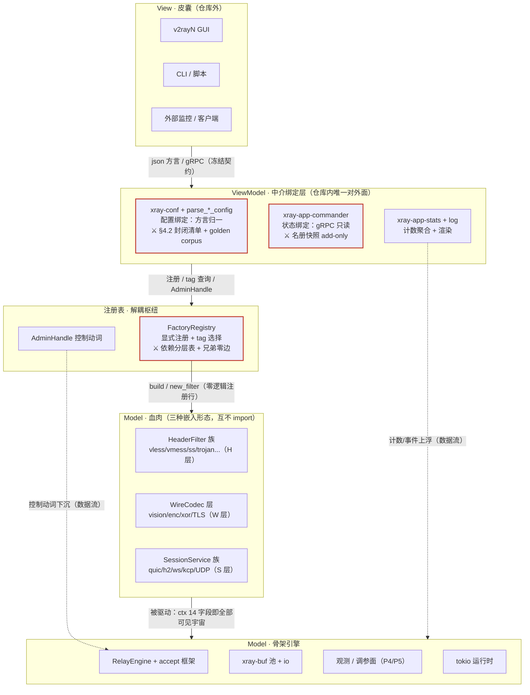

# 裁决 v3：MVVM 增补 —— ViewModel 显式化与解耦三律机械化

- 日期：2026-10-11 ｜ 角色：FramingArch ｜ 前序：v1（`docs/refs/oracle-framing-arch.md`）、v2（`D:/tmp/oracle-framing-v2.md`）、宪法 `ARCHITECTURE.md`
- 定案前提：所有者选择 **MVVM**（明确排除 MVC）：View ⊥ Model，一切经 ViewModel
- 性质：**增量裁决**——v2 的 RelayFilter/RelayEngine/三嵌入形态/P0 护栏全部不变；v3 只做三件事：给 ViewModel 立边界、把解耦三律机械化、补一张 MVVM 全景图

---

## 0. 心证摘要

| 问题 | 裁决 |
|---|---|
| ViewModel 边界 | **宪法 §4.1/§4.2 已经是 ViewModel 契约的雏形**（配置形态兼容承诺 + commander 边界条款"皮囊不触碰血肉内部结构"），v3 不立新承诺，只做三件事：给它命名（ViewModel）、补缺口（状态绑定面纪律）、上锁（机械化检查） |
| 解耦三律 | 注册表律=**显式注册函数 + config tag 选择**（inventory/linkme 否决，可翻转型）；窄接口律=**三层依赖白名单 + ConnCtx 14 字段冻结**；框架驱动律=v2 已覆盖，加 AdminHandle 控制通道即闭环。全部机械化：CI 脚本 + cargo-deny + clippy 三件套，**解耦不靠自觉** |
| 全景图 | 五层 MVVM 图（§3），建议替换宪法 §0 |
| 迁移修正 | **新增 P2.0 槽位：注册表改造**（先于 P2.5 引擎，与 P1/P2 并行）；vmess 首迁不变；P0 扩展三件廉价护栏；AllocGuard 数字全部继续有效且升级为跨层抽查器 |
| 事件管理器（追加裁决） | **做"预布线 + 规范封装"，不做总线**：T1 连接生命周期=引擎同步直调 + 有界有损观察者通道；T2 进程管理=watch（配置热更载体）；T3 数据面告警=计数 + 既有 ctx 控制，**不设新通道**。血肉自定义事件 YAGNI 否决（§7） |
| 血肉可见面（追加裁决） | **五件套正面清单冻结**：日志门面 / 事件管理器 / buffer 池 / 受监督调度 / 热调参读取——之外皆禁；ConnCtx 冻结字段 14→15（+`tuning()`，所有者指令即 RFC 记录）（§7.4） |

---

## 1. 事实基础

1. **配置绑定面已有宪法实体**：`ARCHITECTURE.md` §4.2「v2rayN 混排形态承诺清单」= 已实证形态的**封闭清单** + 边界条款（"发现一个、修复一个、单测钉一个"，禁止猜测性兼容）+ 六步演进程序（用户实锤 → grep Go 基线 → 入口分支归一 → 单测钉死+硬错负例 → commit 写明症状 → 清单加行）。d0555c26（SS 双形态：v2rayN 裸字段 vs Go servers 数组，入口一次分支映射同一 `first` 引用，后续零改动，+4 单测）就是该程序的执行样例。
2. **状态绑定面有雏形无纪律**：commander（xray-app-commander gRPC）+ stats 计数已存在；宪法 §4.1 有"commander 是管理面入口、皮囊不触碰血肉内部"条款；但计数命名无冻结机制、观测项演进无归属规则（现状 stats 名如 `outbound>>>tag>>>traffic>>>downlink` 实际已是外部可见契约，xray-app-dispatcher/src/default.rs:376 注释在用）。
3. **反注册表现状实证**：`xray-core/src/outbound.rs:650` 起 `build_protocol_handler` 的 `match ob.entry.kind.as_str()` 中央臂**不是纯分发**——freedom 臂内嵌 finalRules 预构建、policyManager 档位、dialerProxy 判定等协议构造逻辑（outbound.rs:694-730 一带），inbound 侧同型（Main 引 :2687）。每加协议=改中心文件，血肉与组合根耦合的实体就是这里。
4. View 在仓库外（v2rayN/CLI），仓库内的"对外面"= xray-conf + commander + stats + log——MVVM 的 ViewModel 即这四者的总称 + 一套边界法。

---

## 2. Q1：ViewModel 层显式化

### 2.1 命名与总边界

**ViewModel = View 绑定面的总和**，仓库内恰好四个 crate 群 + 一条规则：

| 绑定面 | crate | View 看到的 | 冻结物 |
|---|---|---|---|
| 配置绑定（View→Model） | xray-conf + 各血肉的 `parse_*_config` 入口 | v2rayN json 方言 | 宪法 §4.2 封闭清单 + 归一入口签名 |
| 状态绑定（Model→View，只读） | xray-app-commander、xray-app-stats、xray-app-log | gRPC 端点、计数名、日志行格式 | 端点名/计数名/字段名（add-only） |
| 组合根（唯一例外） | xray-core bin、xray-cli | 启动 | — |

MVVM 纪律的仓库内表达：**血肉 crate 不 import commander/stats/conf 的任何符号；ViewModel 不 import 血肉的 Handler/Filter 类型**（只经注册表拿 trait 对象）。View 在仓库外，天然满足 View ⊥ Model，真正要设防的是仓库内的 VM↔M 边界。

### 2.2 ① 配置绑定契约：§4.2 制度化为 View 绑定面

v3 不改一个字地**继承** §4.2 封闭清单与六步程序，只补两件让它成为"内核重构零波及皮囊"的保障机制：

1. **golden config corpus（金样本快照）**：仓库存一组真实 v2rayN 导出配置为 fixture（SS-2022 裸字段那票的实锤样本即首批），每条配 snapshot 断言：`parse → 归一化结构 serde 序列化 → 与快照逐字节一致`。**内核任何重构跑红 snapshot 即违规**——这就是"零波及"的机械化形态，比口头承诺硬。d0555c26 的"+单测钉死"从单票实践升级为全协议 corpus。
2. **归一入口唯一**：每个血肉 crate 恰好一个公开 parse 入口（`parse_xxx_config`，现状已有：config.rs 模式，宪法 §3 recipe 同款），入口内做双形态分支（d0555c26 模式：一次分支映射同一引用，后续零改动）。**归一化之后的内部结构可自由重构，永不外溢**——皮囊只见 json 方言，血肉内部只见归一类型，中间一层就是 MVVM 的 binding。

### 2.3 ② 状态绑定契约：只读 + add-only

- **方向单向**：Model→状态面只产生两种东西：typed events（`ctx.event`，v2 §7）与计数（`ctx.counter`）。血肉/引擎**禁止**直接暴露端点（narrow-interface 律的 tracing/gRPC 禁令）。
- **命名冻结**：计数名/端点名/日志字段名 = View 契约（`outbound>>>tag>>>traffic>>>downlink` 这类名已被外部工具消费），规则 **add-only**：新增随便，改名/删除永远禁止（要退役就标 deprecated 留壳）。
- **演进规则（所有者问的"加观测项只扩 ViewModel"）**：新观测项 = ViewModel 层（stats/log）加聚合与暴露；血肉侧至多加一个 `ctx.counter()`/`ctx.event()` 调用点。**端点定义权只在 VM 层**——血肉不定义 gRPC 面。
- 机械化：stats **名册快照测试**（CI 枚举全部注册计数名与 gRPC 方法名，diff 快照即红）。

### 2.4 ③ ViewModel 自身依赖纪律

- VM **可依赖**：骨架全部、注册表句柄（FactoryRegistry/AdminHandle）、血肉的公开 parse 入口与只读查询 trait。
- VM **不可**：绕过注册表点名血肉类型（`use xray_proxy_vless::...` 只允许出现在血肉自己的 crate 与组合根的注册行里）；在 VM 里写协议语义（解析器归一化除外——那本来就是绑定工作）。
- **组合根例外（诚实条款）**：二进制必须链接血肉 crate（物理现实：feature 门控的 dist 裁剪），允许 `use` 到**注册行**为止（`reg.outbound::<FreedomFactory>("freedom")`），禁止其他调用。逻辑规则与物理规则在此解耦：**链接合法、点名构造非法**。

---

## 3. Q2：解耦三律机械化（解耦不靠自觉）

### 3.1 注册表律

**三形态取舍**：

| 形态 | 优势 | 代价 | 风险 | 判定 |
|---|---|---|---|---|
| inventory/linkme 静态注册 | 加 crate=加依赖，零中心改动 | 链接期魔法：二进制里有哪些协议不可见；dist feature 裁剪变隐式；依赖 MSVC section 黑科技 | 意外打进/漏掉协议；排查链路不可 grep | **否（当前）** |
| 显式注册函数（build_x 转正） | 注册点可 grep；feature/dist 裁剪显式；与 Go features 显式构造同位 | 装配文件每协议一行 | 并行落地期装配行 merge 冲突 | **✅ 选此** |
| config 驱动 tag 选择 | 装配与配置正交，运行时按 tag 取 | — | — | **✅ 叠加其上** |

否决 linkme 的可证伪翻转条件：装配行 merge 冲突在同一个迭代窗口 ≥3 次 → 翻转 linkme（`FactoryRegistry` trait 不变，机制一日可换）——机制与契约分离，今天选 boring 是因为 boring 可换。

**注册表形态**（吸收 outbound.rs match 臂的教训——臂里嵌着构造逻辑，所以工厂签名必须带构建上下文，逻辑随臂回血肉）：

```rust
pub trait OutboundFactory: Send + Sync {
    fn tag(&self) -> &'static str;                       // 也作 config tag
    fn build(&self, e: &BuildEntry, bctx: &mut BuildCtx<'_>) -> Result<BuildOut, BuildError>;
}
pub struct BuildEntry { pub tag: String, pub kind: String, pub data: serde_json::Value } // 归一前的方言原文
pub struct BuildCtx<'a> {   // 现 match 臂外的环境依赖，全部显式化
    pub policy: Option<&'a dyn PolicyManager>,
    pub dns: Option<&'a DnsServiceHandle>,
    pub mux_bridges: &'a mut Vec<(Arc<MuxBridge>, Option<String>)>,
    pub inbound_default_rules: &'a HashMap<String, DefaultRuleType>,
}
```

freedom 臂里的 finalRules/policyManager/dialerProxy 逻辑**原样搬家**进 `FreedomFactory::build`（v2 §9.2 代码搬家铁律同款）；中央文件退化为零逻辑注册行：

```rust
// wiring.rs —— 只有行，没有逻辑
reg.outbound(FreedomFactory); reg.outbound(VlessFactory); reg.inbound(SocksFactory); ...
```

**血肉间零依赖的 CI 断言形态**：`cargo metadata --format-version 1` + 一份声明式分层表（§3.2），脚本断言：血肉 crate 的 normal deps ⊆ 本层白名单，且 **xray-proxy-*/xray-transport-* 相互之间零边**（无边即无法走私类型——Rust 的依赖图就是可见性边界，一条 cargo metadata 检查顶得上所有口头规矩）。实现：`tools/check_dep_tiers.py`（约 50 行）进 CI；豁免走 `docs/refs/dep-tier-waivers.md`（每条带理由+复评日期）。

### 3.2 窄接口律：三层依赖白名单 + ConnCtx 冻结

| 层 | 覆盖 | 允许依赖（normal deps） | 额外禁止 |
|---|---|---|---|
| **H 纯逻辑**（HeaderFilter 血肉） | vless/vmess/ss/trojan/http/socks/dokodemo/loopback/blackhole 核心逻辑 | std、xray-buf、xray-common、xray-crypto、xray-proto、xray-features | tokio、quinn/hyper/h2、`bytes` 直引（走 xray-buf 类型）、tracing、xray-transport、兄弟血肉 |
| **W 连接包装**（WireCodec） | vision/xor/enc 层、xray-tls、xray-reality | H + tokio（default-features=false，仅 io+time）、xray-transport（trait）、rustls 系 | tokio::net、直调 tokio::spawn、tracing 直宏、兄弟血肉 |
| **S 引擎嵌入**（SessionService） | quic/hysteria/tuic、splithttp/grpc、ws、kcp | W + 各自引擎（quinn/hyper/tungstenite）+ tokio（full） | 裸 listener bind（监听由 accept 框架供给）、直调 tokio::spawn（用 `ctx.spawn_supervised`）、tracing 直宏、兄弟血肉 |
| **全局**（所有血肉） | — | — | mimalloc（分配器 workspace 级）、tokio::process、std::thread（宪法 P3 义务） |

dev-dependencies 豁免（测试自由用 tokio full）——表管生产依赖，不管测试。

**ConnCtx 最终字段清单（v2 §7 草图 → 本次冻结，14 项 + §7.4 追加第 15 项 `tuning()`）**：

```rust
// 观测（P4/P6 承诺）
event(level, msg, fields)                 counter() -> StatHandle
// 资源（P1 承诺）
alloc() -> Buffer                         scratch() -> &mut Scratch
// 控制面（P2/P3 承诺）
dial(dest, opts) -> DialTicket            wake()                    // Parked 语义
set_idle(d)                               spawn_supervised(name, fut) -> TaskHandle
// 只读元数据
access: AccessContext                     peer() -> SocketAddr
target() -> Option<&Destination>          now() -> Instant
```

冻结规则：ConnCtx 是骨架里的**具体 struct**（不是 trait，boring 优先）；**加方法 = RFC + 三层白名单再审**（ctx 是血肉可见宇宙的总和，膨胀即耦合）；永不加入：config json、registry 句柄、runtime handle、socket 类型。

**v3 追加修正**：按所有者指令新增第 15 字段 `tuning() -> &TuningSnapshot`（热调参只读快照：当前窗口/超时/限额值 + generation 号，P5 承诺的血肉侧读取口；写路径仍归 AdminHandle）——本条即该 RFC 的记录与批准，冻结纪律本身不变（这是它的第一次行使，不是失效）。

**机械化三件套**（各司其职，不重复造轮子）：
1. `check_dep_tiers.py`（cargo metadata）——管**依赖边**（分层表 + 兄弟零边）；
2. cargo-deny `[bans]`——管**全局禁令**（mimalloc 等）；
3. clippy per-crate `disallowed_methods`（S 层禁 `tokio::spawn` 直调、H/W 层禁 `to_vec` 族）+ `disallowed_types`（血肉禁 `std::net::TcpListener`、tokio::net）+ `disallowed_macros`（血肉禁 tracing 宏）——管**符号级**（依赖边查不到的宏/方法）。

### 3.3 框架驱动律：与 ViewModel 无冲突，补一条控制通道

v2 RelayFilter/SessionService 已覆盖数据面驱动；v3 确认唯一新交互：**控制动词**（改参/断连/重载）从 View 来的路径 = commander(gRPC) → `AdminHandle` trait（骨架实现：引擎控制面 + 热调参 P5 承诺的落点）→ 引擎执行。VM 只翻译不执行；血肉不接收控制动词（要响应对话原语走 Filter 的 ctx.wake/set_idle）。MVVM 三律自此闭环：**血肉被人驱动（v2）、被 VM 查询（计数）、被 VM 控制（AdminHandle）——三条路全部经注册表/骨架，无一环回**。

---

## 4. Q3：MVVM 全景图（宪法 §0 替代图建议）

> 实线=依赖（单向向下，View→VM→注册表→血肉→骨架，永不反向）；虚线=数据流（计数上浮、控制下沉）。⚔ = 机械化检查点。



读法三句：**依赖只向下**（View 永远不知道 Model 存在；血肉永远不知道 commander 存在）；**三处 ⚔ 是全部纪律的执法点**（配置快照、名册快照、依赖分层表——三份 CI 检查管住整个 MVVM）；**血肉可见宇宙 = ConnCtx 14 字段 + 注册表**，除此之外的一切不可见即不可用。

---

## 5. Q4：迁移修正与阶段合并

1. **新增 P2.0 槽位：注册表改造**。次序：**P2.0 先于 P2.5（引擎）**——引擎从注册表取工厂，若先落引擎则引擎落地即背一次装配迁移，顺序反了必返工。P2.0 与 P1（buf 收口）、P2（accept 框架）**并行**：三者文件不相交（装配 wiring/outbound vs xray-buf vs transport 监听循环）。
2. **P2.0 本身 = 纯代码搬家**：每协议一个 PR（match 臂逻辑原样进 Factory::build + 注册行），闸门 = 32/32 integration + golden config corpus 全绿；无性能主张，不设 A/B 闸（不碰数据面）。
3. **vmess 首迁等 v2 迁移序列一字不变**（引擎机制与 MVVM 分层正交；迁移后的协议经注册表接入，属 P2.0 的自然结果）。
4. **P0 扩展三件（廉价护栏，全部进 AllocGuard 同期）**：① `check_dep_tiers.py` + 分层表白名单；② golden config corpus 首批（§4.2 已实证形态各一条 + SS-2022 实锤样本）；③ stats/gRPC 名册快照测试。三件都是"先立执法点再动大手术"的护栏性质，与计数分配器同级。
5. **AllocGuard P0 数字：继续有效，确认无修正**——且升级：稳态 0 alloc/chunk 闸门不变，另兼任分层抽查（CI 冒烟对 H 层协议跑一次连接，断言除池/ctx 外零分配——验证血肉没绕开窄接口）。
6. **宪法落点建议**：v3 的 §2（VM 契约）补进宪法 §4；§3 三律机械化表进 §6 纪律机制；§4 全景图替换 §0；本文本身按治理输入惯例存 `docs/refs/`（与 v1/v2 同列，PM 定）。
7. **事件管理器落点（追加裁决）**：T1 生命周期预布线随 **P2.5 引擎**同批落地（引擎本来就要在半关闭/关闭处发通知，顺手接 tap）；T2 watch 随 **P3 热调参**落地（配置热更的载体就是它）；首批观察者=observatory、online-ip、admin 活跃连接表（三者现状的隐式计数改造为显式订阅）。

---

## 6. 可证伪条件

| 信号 | 推翻什么 |
|---|---|
| golden corpus 频繁误报（内核无重构也红） | 快照粒度太细（归一化结构不该整体序列化），改字段级断言而非推翻契约 |
| 分层表白名单两周内豁免 >5 条 | 分层切分错（某能力放错层），重新切层而非堆积豁免 |
| 装配行 merge 冲突单窗口 ≥3 次 | 翻转 linkme（§3.1 预设的翻转条件，机制可换契约不动） |
| ConnCtx 冻结后首个新协议需要第 15 字段 | 走 RFC 加字段是**正常演进**；连续 ≥3 个新协议都要加才说明 14 字段设计错 |
| P2.0 搬家某协议 PR 超 3 天 | 工厂签名（BuildCtx）缺环境依赖，补 BuildCtx 而非放宽注册表律 |

**置信度**：ViewModel 边界与三律机械化——**高**（宪法 §4.1/4.2、commander 条款、match 臂逻辑均已验锚，机械化方案全是标准工具链）；registry 形态取舍——**高**（显式注册与本仓 build_x 惯例零迁移成本，linkme 翻转条件已留）；ConnCtx 14 字段——**中高**（首迁 vmess 前属冻结草案，RFC 通道常开）；全景图——**高**（纯结构陈述）。

---

## 7. 追加裁决（所有者指令，并入 v3）：消息与事件管理器 + 血肉可见五件套

> 红线先行：事件面**总量预算 ≈ 1 个文件 ~200 行**（`ConnEventRecord` + `LifecycleTap`（有界 mpsc）+ `MgmtWatch`（watch channel）+ 一个 drain task）。超出这个体量就是做成了总线框架——砍。事件管理器是"mpsc/broadcast 的规范封装 + 生命周期事件预布线"，不是消息中间件。

### 7.1 事件分类 × 通道形态

| 类 | 事件 | 消费者 | 通道裁决 | 背压语义 |
|---|---|---|---|---|
| **T1 连接生命周期** | accept / 握手完成 / 半关闭 / 关闭（含关闭原因分类，走 RelayError 分类） | 骨架内观察者：observatory、online-ip、admin 活跃连接表、观测 gauge。**RelayFilter 不经此**（见 §7.3） | 引擎**同步直调** `filter.on_event`（热路径零间接，v2 定案不动）；第三方观察者=启动期显式注册的 `LifecycleTap`（有界 mpsc + 单 drain task）——运行时不开放订阅注册 | 满即丢 + 丢弃自计数 `events_dropped{tap}`，**永不反压数据泵** |
| **T2 进程管理** | 配置热更（P5 承诺的运行载体：窗口/超时新值 + generation 号）、shutdown、stats 采样 tick | 引擎、S 层血肉（可订阅热更）、VM | `tokio::sync::watch`（状态语义：最新值胜出、天然有损——正合语义；broadcast 否决：无回放需求；mpsc 否决：多订阅者要中心路由，watch 就是状态广播正解） | watch 无背压问题（读端永远拿最新） |
| **T3 数据面告警** | 水位告警 / 限速触发 / rekey | 观测面 + 本连接控制 + policy 聚合（app-policy 读计数） | **不设新通道**：量级 → counter（`ctx.counter`）；离散 → `ctx.event`（日志时间线）；连接内控制 → 既有 ctx 方法（`set_idle`/`PauseRead`）。rekey 是 wirecodec 状态机内部事，日志即可——无外部订阅者存在 | — |

选型总原则：**控制流不坐事件通道**。dial 完成、半关闭决策、错误处理都是引擎同步直调——事件通道丢了只损失诊断信息，不损失正确性。

### 7.2 事件风暴与背压语义（订阅者慢了怎么办）

三条铁律：①一切观察者通道**有界**；②满即丢 + 自计数，**绝不阻塞泵**——事件为诊断服务，永不为事件牺牲吞吐（splice 双 revert 教训的推广：观测不可税〔mem〕）；③风暴时的系统行为=泵照跑、tap 丢事件、`events_dropped` 计数上浮告警——**丢弃本身可观测**，这比无界队列囤积（内存泄漏税，s9/s12 前科〔mem〕）诚实得多。慢订阅者的修法是批量 drain（聚合），不是加缓冲。

### 7.3 与 RelayFilter.on_event / stats 观测面的关系（单一真相规则，避免双通道）

- **on_event 不是事件管理器的订阅者**：它是引擎对 filter 的同步直调（连接内控制流），事件管理器只服务连接外观察者。一源两汇：引擎发一次，filter 同步收到（必须快），T1 tap 异步收到一份轻量 `ConnEventRecord`（Copy 结构，无 payload）。
- **计数是第一真相，事件是时间线补充**：任何事实只在一处记账——量级进 counter（直接原子加，**不可丢**），离散转折进 T1 事件（**可丢**，服务诊断），人类叙事进 `ctx.event` 日志。stats **永不依赖事件消费来聚合**（事件丢弃不得污染计数）——两者保真度等级不同，结构上就不是重复通道。

### 7.4 血肉可见五件套（正面清单，宪法 §1 承诺的最终形态）

| # | 门面 | 入口 | 规范要点 |
|---|---|---|---|
| 1 | **日志门面** | `ctx.event(level, msg, fields)` | 固定注入字段：`conn_id`（引擎分配）/`stage`（accept/handshake/relay/close）/`inbound_tag`/`target`/`email`——引擎在 accept 时建 span，血肉调用自动携带，**问题定位到 stage/连接是结构保证不是日志自觉**。级别纪律：ERROR=功能受损需人工；WARN=降级/可疑自愈；INFO=生命周期转折；DEBUG=帧细节（tracing filter 默认关，防压测日志洪泛）。**对端断开不是 ERROR**——级别跟 RelayError 分类走（P6 承诺），血肉不得自行拔高 |
| 2 | **事件管理器** | 生命周期=引擎预布线（血肉零动作）；S 层可 `ctx.subscribe_mgmt()` 订阅热更 | §7.1 形态；H/W 层无订阅口（无场景即无 API） |
| 3 | **buffer 池** | `ctx.alloc()` / `ctx.scratch()` | P1 承诺 |
| 4 | **调度** | `ctx.spawn_supervised(name, fut)` | P3 承诺；会话表登记、终局回收（s9/s10 泄漏类封死） |
| 5 | **热调参读取** | `ctx.tuning() -> &TuningSnapshot` | 第 15 字段（§3.2 修正记录）；只读快照 + generation，写路径归 AdminHandle |

**五件之外皆禁**：tokio 直用（S 层白名单例外不变）、socket、log 宏、自建 channel、全局 static、自解析配置。负面清单的执法（clippy disallowed 三件套）v2 已立；这份**正面清单**的价值是让血肉开发者"只知道五件套就够写协议"——MVVM 的 ViewModel 对 View 是稳定接口，骨架对血肉同理。

### 7.5 血肉自定义事件：YAGNI 否决

- **现状零场景**：血肉间组合只走 dispatcher/routing；reverse 用专有通道；DNS 有自己的订阅者；跨协议通知在本仓一个实例都不存在。
- **类型归属悖论**：事件枚举归骨架 → 血肉加变体必须改骨架（正是注册表律要删的耦合）；归血肉 → 订阅者依赖兄弟血肉类型（违反零边律）。结构上无解，除非真需求出现。
- **再议判据（全部满足才开 RFC）**：≥2 个互不隶属的血肉组件需要同一切面通知，且计数/轮询表达不了，且无骨架内置事件可承载。
- 血肉今天想"发布"什么 → `ctx.event`（日志时间线）或 counter（量级）——那是**观测语义**，不是消息语义，且两个口都是五件套。

### 7.6 追加可证伪条件

| 信号 | 动作 |
|---|---|
| T1 tap 丢弃计数常态非零（>0.1%） | 观察者消费太慢：改批量 drain 聚合，**不加缓冲、不限泵** |
| 出现首个真实跨血肉通知需求 | 按 §7.5 三判据走 RFC；不满足判据一律拒绝 |
| 血肉经 watch 读热更出现撕裂/旧值 bug | TuningSnapshot 加 generation 校验（不匹配重读），**不改通道形态** |
| 事件面实现超 ~200 行/出现"主题注册"字样 | 已越界成总线框架，按红线砍回预布线形态 |

**事件面置信度**：**中高**——通道形态全是标准件（mpsc/watch/直调），容量与丢弃率数字待 P2.5 实测校准；YAGNI 否决的置信度**高**（零场景是可 grep 的事实）。
